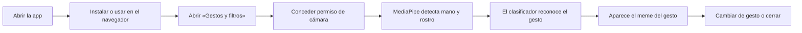

# 01 · Qué es MemeVision

> **Parte de la guía:** [Índice](./README.md) · **Siguiente:** [02 · PWA desde cero](./02-pwa-desde-cero.md)

## 1. En una frase

MemeVision es una **PWA** que usa la cámara del dispositivo para reconocer gestos de la mano y del rostro, y responde mostrando un **meme** en tiempo real. Todo el procesamiento ocurre en el navegador: el video no se envía a ningún servidor.

## 2. Qué problema resuelve

La idea nace de una limitación típica de las apps de visión artificial: normalmente el video se sube a un servidor, se procesa allí y vuelve un resultado. Eso tiene tres costos:

- **Privacidad:** el video y los datos biométricos salen del dispositivo.
- **Dependencia de red:** sin internet no hay inferencia.
- **Latencia y costo:** cada fotograma viaja por la red y consume servidor.

MemeVision invierte el modelo: **la inferencia ocurre en el cliente**. El navegador descarga una vez los modelos y el runtime, y después puede trabajar sin conexión. El servidor solo entrega archivos estáticos (HTML, JS, CSS, WASM y modelos).

## 3. Qué es y qué no es

| Es | No es |
| --- | --- |
| Una PWA instalable desde el navegador | Una app nativa de Android/iOS (no hay APK/IPA) |
| Una app de visión artificial on-device | Un servicio con backend que procesa video |
| Una app que funciona offline tras la primera carga | Una app que entrena modelos en el teléfono |
| Un proyecto académico con alcance acotado | Una red social, un editor de memes o una app de producción a gran escala |

## 4. Flujo de usuario

Pasos concretos de la demo:

1. Abre la app con conexión.
2. Entra a **«Gestos y filtros»** al menos una vez. Esto descarga y cachea los modelos `.task` (~12 MB) y el WASM (~14,5 MB). Es el paso que muchas veces se olvida.
3. Si quieres probar offline, desconecta la red.
4. Vuelve a abrir la app y entra a «Gestos y filtros».
5. Haz uno de los gestos: 👍 like, ✌️ peace, 👌 ok, 🤟 rock, ✊ fist, 🖐 palm, ✋ stop, ☝️ one, 🔫 pistola, 📞 llamada, 🫡 saludo, 🤫 silencio o 😼 mewing.
6. El meme correspondiente aparece cuando el gesto se mantiene estable.

## 5. Las pantallas y qué hace cada una

| Pantalla / elemento | Qué hace | Código |
| --- | --- | --- |
| Panel principal | Presenta la app, contador de creaciones y formulario | `src/main.ts` |
| «Cámara en vivo» | Foto o video con audio, cambio frontal/trasera, ubicación y guardado | `src/main.ts` + `src/dispositivo.ts` |
| «Gestos y filtros» | Bucle de visión, meme, confianza, puntos de depuración | `src/vision/ui-gestos.ts` |
| «Mis creaciones» | Lista, visor y eliminación de fotos/videos guardados | `src/main.ts` + `src/datos/db.ts` |
| Cifrado de notas | Deriva una clave de la contraseña y cifra la nota privada | `src/datos/cripto.ts` |
| Service Worker | Cachea el shell, los modelos y el WASM; permite offline | `vite.config.ts` + `src/main.ts` |

Las pantallas «Desafíos» y «Configuración» son parte del diseño visual, pero no tienen lógica funcional en esta versión.

## 6. Qué está implementado

| Funcionalidad | Estado | Dónde |
| --- | --- | --- |
| Manifest e instalación PWA | Sí | `public/manifest.json`, `vite.config.ts` |
| Service Worker y offline | Sí, tras la primera carga | `vite.config.ts` |
| Cámara, micrófono y ubicación | Sí | `src/dispositivo.ts` |
| Foto y video con audio | Sí | `src/main.ts` |
| IndexedDB y cifrado de notas | Sí | `src/datos/` |
| Detección de manos y rostro | Sí | `src/vision/motor.ts` |
| Reglas geométricas | Sí | `src/vision/reglas.ts` |
| MLP entrenado | Implementado, pero sin modelo exportado | `src/vision/mlp.ts`, `nucleo/` |
| Guardar memes generados por gesto | No | — |
| Descargar/compartir meme | No | — |
| Aviso de conexión | No | — |
| Inferencia en Web Worker | No; corre en el hilo principal | `src/vision/ui-gestos.ts` |

## 7. La demo que debes poder contar

> “Instalo la PWA, abro «Gestos y filtros» una vez con internet para que se descarguen los modelos, desconecto la red, vuelvo a abrir la app, hago un pulgar arriba y aparece el meme. Todo el procesamiento ocurre en el navegador; el video nunca sale del dispositivo.”

**Ojo:** si no abres «Gestos y filtros» antes de desconectar, los modelos no están en caché y la vista de gestos no puede arrancar. Es una limitación actual del flujo offline, no del clasificador.

## 8. Elevator pitch

### 30 segundos

> “MemeVision es una PWA que convierte gestos en memes usando visión artificial en el navegador. La cámara detecta manos y rostro con MediaPipe, un clasificador propio decide el gesto y la app muestra un meme. Todo ocurre en el dispositivo, funciona offline después de la primera carga y no envía video a ningún servidor.”

### 2 minutos

> “El proyecto nace de una idea: hacer visión artificial sin subir video a un servidor. Para eso usamos una PWA con Vite y TypeScript, MediaPipe Tasks Vision ejecutándose en WebAssembly y un clasificador propio. MediaPipe nos da 21 puntos de la mano y 478 del rostro con 52 expresiones; nosotros los convertimos en un vector de 127 características y clasificamos con reglas geométricas o con un MLP entrenado en Python. El MLP se exporta como JSON y se ejecuta en TypeScript, así que el teléfono no necesita Python. La app se instala, cachea modelos y recursos con Workbox y funciona offline. La privacidad es el eje: el video nunca sale del dispositivo.”

## 9. Para la defensa

| Pregunta probable | Respuesta corta |
| --- | --- |
| ¿Qué es una PWA? | Una app web que se instala, tiene manifest y Service Worker y puede funcionar offline. |
| ¿Por qué no una app nativa? | Porque el objetivo era demostrar la Web Platform: una sola base de código, instalable desde el navegador y sin tiendas. |
| ¿Dónde corre la IA? | En el dispositivo: MediaPipe en WASM y el MLP en TypeScript. |
| ¿El video sale del dispositivo? | No. Solo se descargan archivos estáticos; no hay backend ni subida de video. |
| ¿Qué pasa si no hay internet? | Funciona offline después de la primera carga de la app, los modelos y el WASM. |
| ¿Qué falta? | Entrenar/exportar el MLP, precargar modelos para offline, guardar los memes, compartir/descargar y mover la inferencia a un Web Worker. |

## 10. En el proyecto

- Especificación: [`MemeVision_Especificacion_Requisitos.docx`](../../../documentacion/MemeVision_Especificacion_Requisitos.docx) (documento del curso, fuera del repo).
- Propuesta: [`MemeVision_Propuesta_PWA.pptx`](../../../documentacion/MemeVision_Propuesta_PWA.pptx) (documento del curso, fuera del repo).
- README del repo: [`../README.md`](../README.md).
- Flujo técnico: [07 · Arquitectura y flujo](./07-arquitectura-y-flujo.md).
- Glosario: [GLOSARIO.md](./GLOSARIO.md).

---

**Siguiente:** [02 · PWA desde cero](./02-pwa-desde-cero.md)
