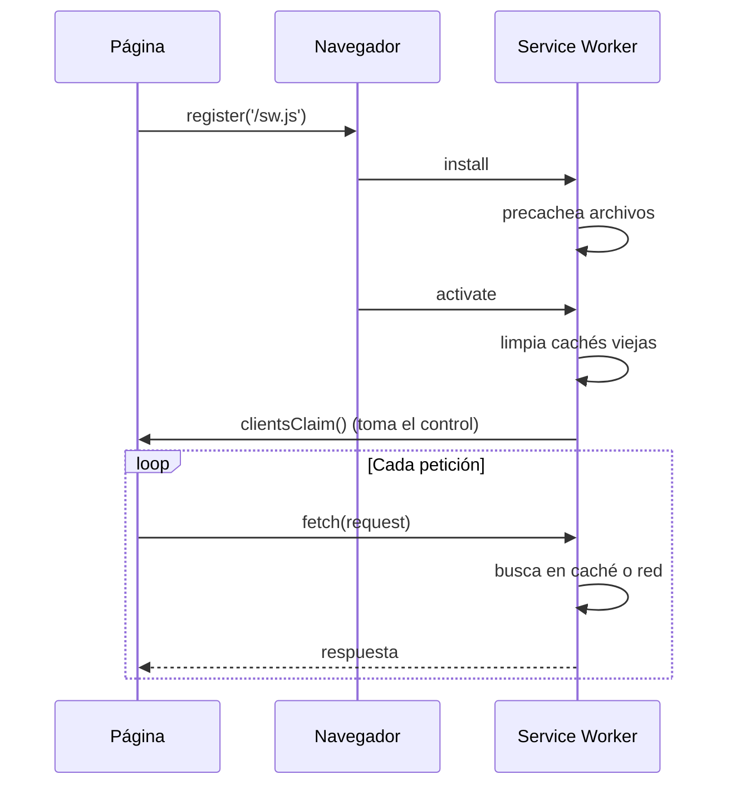

# 02 · PWA desde cero

> **Parte de la guía:** [Índice](./README.md) · **Anterior:** [01](./01-que-es-memevision.md) · **Siguiente:** [03](./03-responsive-y-movil.md)

## 1. Qué es una PWA

Una **Progressive Web App** es una aplicación web que se comporta como una app instalada:

- Se puede **instalar** desde el navegador y queda con ícono en la pantalla de inicio.
- Abre en una ventana propia (`standalone`), sin la barra del navegador.
- Puede **funcionar offline** o con red intermitente.
- Usa las capacidades del dispositivo (cámara, micrófono, ubicación, almacenamiento).
- Se actualiza desde el servidor, sin tiendas de aplicaciones.

En la práctica, una PWA “cumple” si tiene:

1. **HTTPS** (o `localhost` para desarrollo).
2. Un **Web App Manifest** válido.
3. Un **Service Worker** registrado y con una estrategia de caché.
4. Un **punto de entrada** (`start_url`) y un **display** razonable (`standalone`).

MemeVision cumple los cuatro. El matiz es que el Service Worker se genera en el **build**; en `npm run dev` no tienes la experiencia PWA completa.

## 2. Contexto seguro: por qué HTTPS no es opcional

Cámara, micrófono, geolocalización y Service Worker solo funcionan en un **contexto seguro**:

- `https://` en producción.
- `http://localhost` o `http://127.0.0.1` en desarrollo.

Si abres la app desde el celular con `http://192.168.1.50:5173`, el navegador no permitirá la cámara ni el Service Worker. Para probar en un teléfono necesitas HTTPS (túnel, despliegue o certificado local).

## 3. Manifest: la “carta de presentación” de la app

Archivo: [`public/manifest.json`](../public/manifest.json). Campos importantes:

| Campo | Valor en MemeVision | Para qué sirve |
| --- | --- | --- |
| `name` | `Meme Vision` | Nombre completo al instalar |
| `short_name` | `Meme Vision` | Nombre corto en el ícono |
| `id` | `/` | Identidad de la app instalada |
| `start_url` | `/` | Página que abre al iniciar |
| `scope` | `/` | Rutas que pertenecen a la app |
| `display` | `standalone` | Sin barra del navegador |
| `orientation` | `portrait` | Bloquea la orientación vertical al instalar |
| `background_color` | `#f7f7f2` | Fondo mientras carga |
| `theme_color` | `#f7f7f2` | Color de la barra del sistema |
| `icons` | 192, 512 y 512 maskable | Íconos de instalación |
| `screenshots` | wide y mobile | Vista previa en la instalación |

`manifest.json` se enlaza desde `index.html` con `<link rel="manifest" href="/manifest.json" />`.

**Ojo con las rutas:** `start_url`, `scope` e íconos usan `/`. Si algún día despliegas en un subpath (por ejemplo `usuario.github.io/Meme-Vision/`), hay que cambiarlos a rutas relativas o ajustar `base` en Vite. En Cloudflare Pages se sirve en la raíz del dominio, así que este punto no afecta al despliegue actual.

## 4. Service Worker: el “intermediario” de red

Un Service Worker es un script que el navegador ejecuta en segundo plano. No tiene DOM, pero puede interceptar peticiones (`fetch`) y responder desde caché.

### Ciclo de vida

- **install:** se descargan y guardan los archivos del precaché.
- **activate:** se eliminan versiones viejas de caché y el SW toma el control de las pestañas abiertas.
- **fetch:** cada petición pasa por las estrategias de caché.

En MemeVision, Workbox genera `dist/sw.js` y `dist/workbox-*.js` en `npm run build`. La app registra el SW con `registerSW({ immediate: true })` en `src/main.ts`.

## 5. Workbox: no escribimos el Service Worker a mano

El proyecto usa `vite-plugin-pwa` con Workbox. La configuración está en [`vite.config.ts`](../vite.config.ts).

### Precache vs. runtime cache

| Tipo | Qué guarda | Cuándo |
| --- | --- | --- |
| **Precache** | Shell: HTML, JS, CSS, PNG de memes, JSON | Durante el build / instalación |
| **Runtime cache** | `.task`, WASM, `gestos_mlp.json`, `/api/` | La primera vez que se piden |

El precaché se genera a partir de `dist/` con `globPatterns: ['**/*.{html,js,css,png,json}']`. Por eso los memes y el shell funcionan offline desde el primer momento. Los `.task` y el WASM son demasiado grandes para el precaché y se cachean cuando se usan.

### Estrategias configuradas

| Ruta | Estrategia | Caché | Comportamiento |
| --- | --- | --- | --- |
| Shell (`html/js/css/png/json`) | Precache | Workbox | Disponible desde la instalación |
| `/assets/meme-vision-(icon\|screenshot)` | CacheFirst | `imagenes` | 60 entradas, 30 días |
| `/api/` | NetworkFirst | `api-memes` | Red primero; respaldo en caché |
| `/modelos/gestos_mlp.json` | NetworkFirst (3 s) | `modelo-gestos` | Red primero; si tarda, caché |
| `/modelos/` (`.task`) | CacheFirst | `modelos-vision` | 12 entradas, 30 días |
| `/wasm/` | CacheFirst | `wasm-vision` | 12 entradas, 30 días |

### La consecuencia más importante para la demo

**Los modelos `.task` y el WASM no están en el precaché.** Se guardan la primera vez que abres «Gestos y filtros». Por eso:

- Si instalas la app y desconectas sin abrir esa vista, la visión no funciona offline.
- Si la abres una vez con conexión, después funciona sin red.
- Es una brecha frente al flujo ideal “instalar → desconectar → usar” de la especificación.

Esto se puede mejorar precargando los modelos o añadiendo un botón “Preparar modo offline”. Hoy no está implementado.

## 6. Actualización del Service Worker

El proyecto usa:

- `registerType: 'autoUpdate'`
- `skipWaiting: true`
- `clientsClaim: true`
- `cleanupOutdatedCaches: true`

Y en `src/main.ts`:

- Comprueba actualizaciones al volver a la pestaña (`visibilitychange`) y cada hora.
- Si ya había un SW controlando, escucha `controllerchange` y recarga una sola vez.
- Evita recargar en la primera visita.

**Qué significa para el usuario:** al desplegar una versión nueva, el SW se actualiza, toma el control y la app recarga una vez si ya estaba abierta. Si la app está instalada y offline, no verá la actualización hasta volver a tener red.

## 7. Instalación en cada plataforma

| Plataforma | Cómo se instala | Notas |
| --- | --- | --- |
| Android (Chrome/Edge) | Menú → “Instalar app” o aviso del navegador | Es la experiencia más completa |
| Escritorio (Chrome/Edge) | Ícono de instalar en la barra de direcciones | Abre en ventana propia |
| iOS/iPadOS (Safari) | Compartir → “Añadir a pantalla de inicio” | No hay `beforeinstallprompt`; algunas APIs cambian |
| Firefox | No ofrece instalación completa en todas las versiones | La app igual funciona como web |

MemeVision **no** implementa un botón propio de “Instalar”: la instalación se hace desde el menú del navegador. Eso es válido, pero se puede mejorar con `beforeinstallprompt` en Chrome/Android.

## 8. Desarrollo vs. build vs. producción

| Comando | Qué tienes | ¿SW/offline? |
| --- | --- | --- |
| `npm run dev` | Vite con recarga en caliente | No (el SW no se genera en dev) |
| `npm run build` | `dist/` con SW y Workbox | Sí, al servir `dist/` |
| `npm run preview` | Sirve `dist/` en localhost | Sí, es la forma de probar la PWA |
| Cloudflare Pages | Sirve `dist/` en HTTPS | Sí, es la producción |

Para probar offline: `npm run build` → `npm run preview` → DevTools → Application → Service Workers → Offline → recargar. O instalar la PWA y desconectar la red.

## 9. Errores comunes

| Síntoma | Causa probable | Solución |
| --- | --- | --- |
| La cámara no abre | No es HTTPS ni localhost | Usa `https` o `localhost` |
| El SW no aparece | Estás en `npm run dev` | Usa `npm run build` + `npm run preview` |
| Cambios no se ven | SW viejo o caché | Cierra pestañas, recarga, revisa Application → Service Workers |
| 404 en modelos | No se abrió «Gestos y filtros» o falta `dist/modelos` | Revisa `public/modelos` y el build |
| 404 en WASM | `predev`/`prebuild` no copió el WASM | Ejecuta `npm run dev` o `npm run build` |
| La app no se instala | Falta manifest, íconos o HTTPS | Revisa `manifest.json` y el contexto seguro |

## 10. Para la defensa

| Pregunta | Respuesta |
| --- | --- |
| ¿Qué diferencia hay entre caché HTTP y Service Worker? | La caché HTTP es del navegador; el SW intercepta peticiones y decide la estrategia. Workbox gestiona ambas. |
| ¿Por qué Workbox y no un `sw.js` manual? | Workbox genera el precaché con hashes, maneja versiones y reduce errores; el `sw.js` manual de las sesiones 17-21 quedó reemplazado. |
| ¿Qué se cachea primero? | El shell en el build; los modelos y el WASM en la primera visita a «Gestos y filtros». |
| ¿Cómo se actualiza la app? | `skipWaiting` + `clientsClaim`; la app busca actualizaciones al volver a la pestaña y cada hora. |
| ¿Funciona en iOS? | Sí, como PWA instalada desde Safari; la instalación es manual y algunas APIs tienen diferencias. |

## 11. En el proyecto

- Manifest: `public/manifest.json`.
- Configuración de Workbox: `vite.config.ts`.
- Registro y actualización: `src/main.ts`.
- Copia del WASM: `scripts/copiar-wasm.mjs`.
- Despliegue: [08 · Cloudflare Pages](./08-despliegue-cloudflare.md).

---

**Siguiente:** [03 · Responsive y móvil](./03-responsive-y-movil.md)
