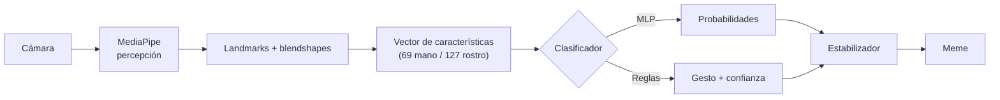
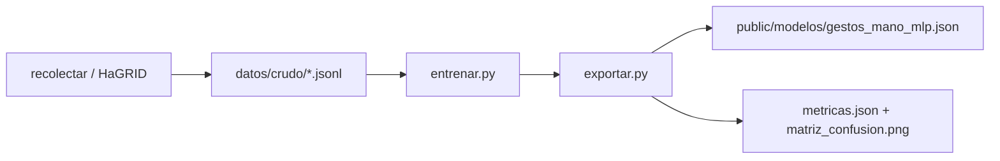

# 04 · Visión e IA desde cero

> **Parte de la guía:** [Índice](./README.md) · **Anterior:** [03](./03-responsive-y-movil.md) · **Siguiente:** [05](./05-datos-y-almacenamiento.md)

## 1. Los conceptos mínimos

### Modelo
Un **modelo** es una función que transforma una entrada en una salida. En este proyecto hay dos tipos:

- **Modelo de percepción** (MediaPipe): recibe una imagen y devuelve puntos del rostro o de la mano.
- **Modelo de clasificación** (MLP o reglas): recibe números y devuelve un gesto.

### Entrenamiento e inferencia
- **Entrenamiento:** se muestran ejemplos etiquetados («esto es un like», «esto es silencio») y se ajustan los parámetros del modelo para que acierte.
- **Inferencia:** se usa el modelo ya entrenado para predecir un ejemplo nuevo.

En gestIA, el entrenamiento ocurre en un PC con Python; la inferencia, en el navegador.

### Características (features)
Son los números que resumen un ejemplo. En vez de pasar la imagen cruda al clasificador, se extraen medidas: posiciones de la mano, expresiones faciales, distancias. Eso hace el problema más pequeño y más fácil de aprender.

### Etiquetas (labels)
Son las clases que queremos predecir. El modelo entrenado usa diez: `llamada`, `ok`, `peace`, `rock`, `fist`, `palm`, `stop`, `one`, `pistola` y `ninguno`. La app reconoce además gestos que resuelven las reglas y no el MLP: `like`, `dislike`, `silencio`, `mewing` y `saludo`.

### Probabilidad y umbral
Un clasificador devuelve una probabilidad por clase. El **umbral** decide cuándo aceptar la predicción: si la probabilidad máxima no lo supera, se usa el respaldo.

### Sobreajuste (overfitting)
El modelo memoriza los ejemplos de entrenamiento pero falla con personas nuevas. Se combate con más datos, variedad, aumento y separando validación de prueba.

## 2. La arquitectura de dos etapas



La clave: **no entrenamos un modelo desde cero para ver**. Usamos modelos preentrenados de MediaPipe para la parte difícil (detectar puntos en una imagen) y construimos un clasificador pequeño encima. Es más viable para un proyecto académico y funciona sin GPU dedicada.

## 3. MediaPipe: los «ojos» del sistema

### Qué es
MediaPipe es un conjunto de modelos y utilidades de visión de Google. Aquí se usa `@mediapipe/tasks-vision`, que ejecuta los modelos en el navegador con **WebAssembly**. Intenta la GPU (WebGL) y, si falla, cae a CPU.

### Qué devuelve

| Modelo | Salida | Uso en gestIA |
| --- | --- | --- |
| `GestureRecognizer` | 21 landmarks de la mano + categoría de gesto integrado (por ejemplo `Thumb_Up`) | Mano, dedos y respaldo para `like` |
| `FaceLandmarker` | 478 landmarks del rostro + 52 blendshapes | Geometría mano-cara y reglas de rostro |

- Un **landmark** es un punto con coordenadas `(x, y, z)` normalizadas respecto a la imagen.
- Un **blendshape** es un valor de 0 a 1 que mide una expresión facial (sonrisa, boca abierta, ceja, etc.).

### Los archivos `.task`

`public/modelos/gesture_recognizer.task` (~8,4 MB) y `face_landmarker.task` (~3,8 MB) son **paquetes de modelos preentrenados** (TensorFlow Lite + metadatos). **No son el MLP del proyecto**; son los que producen los puntos.

Se ejecutan con el runtime WASM de MediaPipe, no con Python. En el PC, los mismos `.task` se usan desde Python para recolectar datos.

## 4. Los dos esquemas de características

Hay **dos** vectores y dos modelos posibles. No es un detalle: es la decisión de diseño que conviene explicar.

| Modelo | Archivo | Características | Clases | Estado |
| --- | --- | --- | --- | --- |
| **Mano** | `public/modelos/gestos_mano_mlp.json` | **69** | **10** | **Entrenado y en uso** |
| Rostro | `public/modelos/gestos_mlp.json` | 127 | — | Preparado, sin exportar |

`motor.ts` carga los dos y los pasa al fusor. Hoy la app muestra el motor MLP porque existe el de mano.

### Por qué el de mano usa 69 y no 127

El esquema de 127 nació para un modelo que usara blendshapes; el de mano no los usa, así que 52 de las 127 entradas serían ceros. El vector de 69 es más pequeño, más rápido y se entrena con landmarks públicos de **HaGRID** sin depender de una webcam.

Archivo: [`src/vision/caracteristicas-mano.ts`](../src/vision/caracteristicas-mano.ts), espejo de `nucleo/src/meme_vision/caracteristicas_mano.py`.

| Rango | Contenido |
| --- | --- |
| 0–62 | 21 landmarks × (x, y, z) en **forma canónica**: centrados en la muñeca, escalados por la distancia muñeca → nudillo medio y rotados a un eje de referencia |
| 63 | `1` si hay mano, `0` si no |
| 64–68 | Pulgar, índice, medio, anillo y meñique extendidos (`0`/`1`) |

### El vector de 127 (modelo de rostro, sin usar)

Sigue implementado en [`src/vision/caracteristicas.ts`](../src/vision/caracteristicas.ts) y en `nucleo/src/meme_vision/caracteristicas.py`, listo por si se entrena:

| Rango | Contenido | Explicación |
| --- | --- | --- |
| 0–62 | 21 landmarks de la mano × (x, y, z) | Se centran en la muñeca y se escalan por la distancia muñeca → nudillo medio |
| 63–114 | 52 blendshapes faciales | Expresiones del rostro en orden canónico de MediaPipe |
| 115–122 | 8 medidas mano-cara | Índice-boca, índice-mentón, índice-mandíbula, alcance, pulgar-boca, boca-mentón, offset Y, offset X |
| 123–126 | 4 flags | Hay mano, hay rostro, índice extendido, pulgar+meñique |

### Decisiones que conviene poder defender

- **Normalización por escala:** dividir por la distancia muñeca → nudillo medio hace que importe poco si la mano está cerca o lejos.
- **Forma canónica y rotación:** el modelo de mano lleva los landmarks a un eje de referencia para no depender del ángulo de la cámara.
- **Espejo de la mano izquierda:** se multiplica X por `-1` para que el modelo no dependa de la lateralidad.
- **Datos faltantes:** sin mano se rellena con ceros y el flag 63 lo indica.
- **Paridad Python/TS:** `paridad.test.ts` compara el vector de TypeScript contra un fixture generado por Python. Si una implementación cambia sin la otra, el test falla.

## 5. El modelo entrenado, con sus números

`public/modelos/gestos_mano_mlp.json` (versión `2026.11.07-0532`):

```text
entrada (69)
  → capa oculta 1 (128 neuronas, ReLU)   pesos 128×69
  → capa oculta 2 (64 neuronas, ReLU)    pesos 64×128
  → salida (10 neuronas, softmax)        pesos 10×64
umbral: 0,90
```

| Métrica | Valor |
| --- | --- |
| Exactitud (test) | **94,38 %** |
| Macro F1 | **95,27 %** |
| F1 ponderado | 94,43 % |
| Muestras de entrenamiento | 16 100 |
| Validación / prueba | 1 725 / 1 725 |
| Dataset | 11 500 muestras de HaGRID |

> **Leer la letra pequeña.** El propio JSON avisa de que el split es **aleatorio
> por fotograma**, no por sesión ni por persona. Eso hace que las métricas sean
> **optimistas**: miden si el modelo reconoce fotogramas parecidos a los de
> entrenamiento, no si generaliza a una persona nueva. Decirlo en la defensa
> suma; esconderlo, resta.

Los gestos que dependen del **rostro** (`silencio`, `mewing`, `saludo`) los resuelven las reglas: el MLP de mano no ve la cara.

### El JSON del modelo

```json
{
  "version": "2026.11.07-0532",
  "gestos": ["fist", "llamada", "ninguno", "ok", "one", "palm", "peace", "pistola", "rock", "stop"],
  "tamano_entrada": 69,
  "escalador": { "media": ["69 números"], "desviacion": ["69 números"] },
  "capas": [
    { "pesos": ["128×69"], "sesgos": ["128"] },
    { "pesos": ["64×128"], "sesgos": ["64"] },
    { "pesos": ["10×64"], "sesgos": ["10"] }
  ],
  "umbral": 0.9,
  "metricas": { "exactitud": 0.9438, "macro_f1": 0.9527 }
}
```

`mlp.ts` valida que el tamaño, las capas y el escalador sean coherentes. Si el JSON no existe o es inválido, devuelve `null` y la app usa reglas.

## 6. El motor de reglas

Archivo: [`src/vision/reglas.ts`](../src/vision/reglas.ts). Son condiciones geométricas escritas a mano: no aprenden, son deterministas e interpretables.

| Gesto | Regla principal |
| --- | --- |
| `silencio` | Índice extendido y punta a menos de 0,18 de la escala del rostro respecto a la boca (segunda oportunidad a 0,34) |
| `mewing` | Índice extendido, debajo de la boca y a menos de 0,30 de la línea de la mandíbula |
| `saludo` | Mano plana horizontal, muñeca hacia la oreja, altura de frente |
| `llamada` | Pulgar y meñique extendidos; índice, medio y anillo cerrados |
| `like` / `dislike` | `Thumb_Up` de MediaPipe con confianza > 0,5; si no, pulgar extendido sobre la muñeca |
| `ninguno` | Ninguna condición se cumple |

### Ventajas y límites

- **Ventajas:** funcionan desde el primer día, no necesitan dataset, son interpretables y fáciles de depurar.
- **Límites:** dependen de umbrales; pueden fallar con manos pequeñas o lejanas, luces raras, ángulos extremos o proporciones distintas. El MLP generaliza mejor.

### La zona muerta, un detalle que vale contar

Un solo umbral de 150° mezclaba dos decisiones: un dedo a 145° contaba como **cerrado**. Con el ruido de MediaPipe, la mano plana del saludo no se reconocía y la regla de `llamada` se disparaba sola.

La solución fue una **zona muerta** con dos umbrales: por encima de 140° el dedo está claramente extendido, por debajo de 110° claramente cerrado, y en medio no se afirma nada.

**Importante:** `extensiones()` se queda con 150° porque alimenta los flags del MLP de mano y el entrenamiento en Python usa el mismo valor. Las reglas usan `extensionesRegla()` con 140°. Un test fija esa separación para que nadie las iguale por error.

## 7. Prioridad de decisión

Archivo: [`src/vision/fusion.ts`](../src/vision/fusion.ts). El orden es explícito y cada paso existe por una razón:

1. **Reglas de rostro** (`silencio`, `mewing`, `saludo`): el MLP de mano no ve la cara.
2. **`dislike` / `like`**: dependen de la orientación; las reglas de MediaPipe son más fiables que un MLP entrenado con landmarks canonicalizados.
3. **`llamada`**: la regla es muy específica (pulgar + meñique).
4. **MLP de mano**: gestos nuevos que no dependen del rostro.
5. **MLP de rostro**, si algún día se entrena.
6. **`ninguno`**.

Si un MLP no supera **su** umbral, no se usa su predicción: se cae a la regla.

Después de todo eso, el **estabilizador** exige que el gesto aparezca en 5 de los últimos 8 fotogramas, aplica un cooldown de 1,2 s y retiene el gesto 2 s antes de volver a «sin gesto».

## 8. Cómo se ejecuta el MLP en el navegador

Archivo: [`src/vision/mlp.ts`](../src/vision/mlp.ts).

1. Normaliza la entrada con la media y la desviación del escalador.
2. Multiplica por los pesos de cada capa, suma sesgos y aplica ReLU.
3. En la última capa aplica `softmax` para obtener probabilidades.
4. Toma la clase con mayor probabilidad y su confianza.

El JSON incluye `capas[].pesos` ya **transpuestos** por `exportar.py`, porque scikit-learn guarda `[entrada][salida]` y aquí se necesita `[salida][entrada]`.

## 9. Entrenamiento en Python

El flujo completo está en [06 · Núcleo Python](./06-nucleo-python.md). Resumen:



Decisiones clave:

- **Aumento solo en train:** espejo, rotación ±8°, escala 0,9–1,1 y ruido.
- **Pesos balanceados por clase:** si hay menos ejemplos de un gesto, se compensa.
- **Umbral elegido en validación:** se prueba de 0,30 a 0,90 y se elige el mejor macro F1.
- **Reentrenamiento con train+val:** se evalúa una sola vez en test.
- **Métricas:** exactitud, macro F1, F1 ponderado, reporte por clase y matriz de confusión.

> **Deuda declarada:** el modelo en uso se entrenó con un split **aleatorio por
> fotograma**. El código de `entrenar.py` soporta el split por sesión/persona,
> que es el correcto para medir generalización, pero el dataset de HaGRID no
> trae ese agrupamiento. Es la principal línea de mejora.

### Cómo leer las métricas

- **Exactitud:** porcentaje de aciertos. Puede engañar si las clases están desbalanceadas.
- **Macro F1:** promedio del F1 de cada clase, sin importar cuántos ejemplos tenga. Es la métrica principal aquí.
- **F1 ponderado:** promedio pesado por cantidad de ejemplos.
- **Matriz de confusión:** muestra qué gestos se confunden entre sí. Es más útil que un solo número.

## 10. Para la defensa

| Pregunta | Respuesta |
| --- | --- |
| ¿Qué hace MediaPipe y qué hace el proyecto? | MediaPipe percibe (landmarks, blendshapes); el proyecto clasifica el gesto. |
| ¿Qué MLP está entrenado? | El de mano: 69 → 128 → 64 → 10, con umbral 0,90. |
| ¿Qué exactitud tiene? | 94,38 % en test, con macro F1 del 95,27 %. Y es **optimista**, porque el split es por fotograma. |
| ¿Por qué 69 y no 127? | El modelo de mano no usa blendshapes; 52 entradas de ceros solo añadían ruido y cómputo. |
| ¿Por qué hay reglas si existe el MLP? | El MLP de mano no ve la cara; para `silencio`, `mewing` y `saludo` las reglas son la única vía. Además sirven de respaldo bajo el umbral. |
| ¿El teléfono entrena? | No. Python entrena en el PC; el teléfono solo infiere en JS. |
| ¿Qué es el umbral? | La confianza mínima para aceptar una predicción. |
| ¿Cómo evitan el sobreajuste? | Aumento en train, validación y test separados y pesos balanceados. La deuda pendiente es el split por persona. |

## 11. En el proyecto

- MediaPipe y fusión: `src/vision/motor.ts`, `src/vision/fusion.ts`.
- Características: `src/vision/caracteristicas-mano.ts` (69) y `caracteristicas.ts` (127).
- Reglas y geometría: `src/vision/reglas.ts`, `src/vision/mano.ts`.
- Modelo y estabilizador: `src/vision/mlp.ts`, `src/vision/estabilizador.ts`.
- Modelo entrenado: `public/modelos/gestos_mano_mlp.json`.
- Entrenamiento: `nucleo/src/meme_vision/entrenar.py`, `exportar.py`.
- Tests: 13 archivos con **65 pruebas** (`src/vision/*.test.ts`, `src/dispositivo.test.ts`, `src/datos/cripto.test.ts`, `nucleo/tests/`).

---

**Siguiente:** [05 · Datos y almacenamiento](./05-datos-y-almacenamiento.md)
