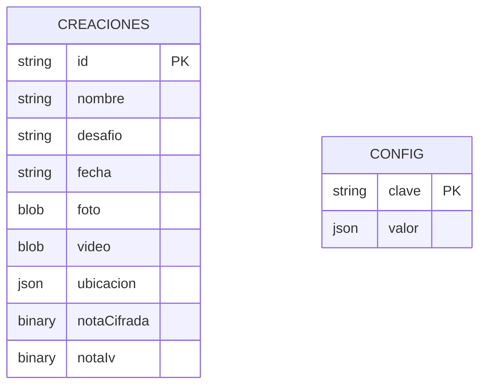
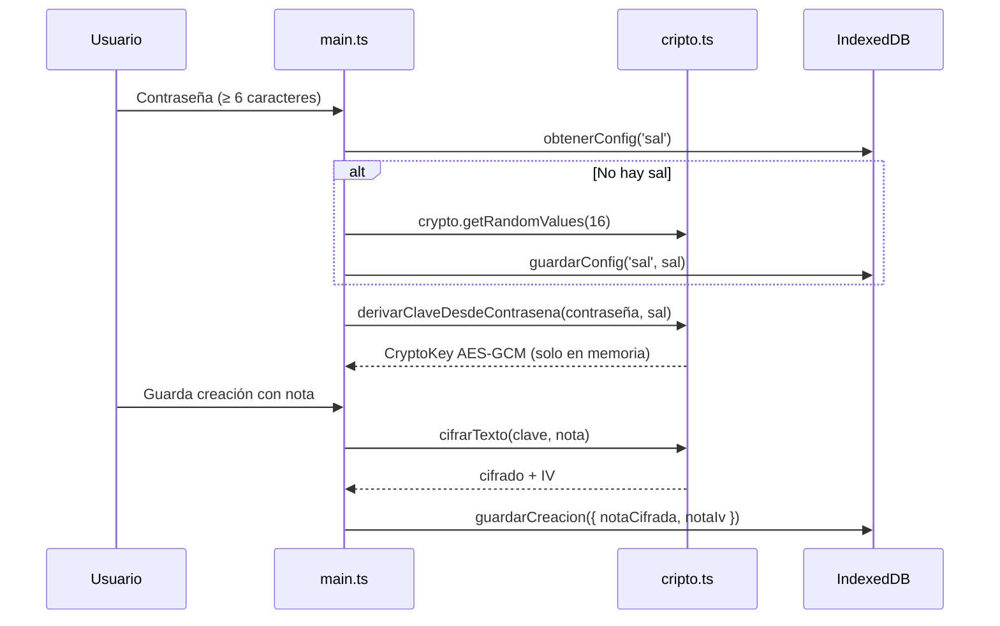

# 05 · Datos y almacenamiento

> **Parte de la guía:** [Índice](./README.md) · **Anterior:** [04](./04-vision-e-ia.md) · **Siguiente:** [06](./06-nucleo-python.md)

## 1. Por qué guardar en el dispositivo

MemeVision no tiene backend. Las creaciones (fotos, videos, ubicación y notas) viven en el navegador. Eso aporta:

- **Privacidad:** los datos no salen del dispositivo.
- **Offline:** la app funciona sin red.
- **Velocidad:** no hay ida y vuelta al servidor.

El costo es que el usuario debe confiar en el navegador y que los datos se pueden perder si borra el almacenamiento del sitio.

## 2. IndexedDB desde cero

IndexedDB es una base de datos NoSQL del navegador. Guarda objetos JavaScript de forma estructurada y permite consultas por índices.

| Concepto | Qué es |
| --- | --- |
| **Base de datos** | Contenedor principal; en el proyecto `memevision-db` |
| **Object store** | Similar a una tabla; aquí `creaciones` y `config` |
| **Registro** | Un objeto guardado; en `creaciones` cada registro es una creación |
| **Clave primaria** | Identificador único; en `creaciones` es `id` |
| **Índice** | Estructura para buscar por un campo; aquí `porDesafio` y `porFecha` |
| **Transacción** | Operación atómica; si falla, no deja datos a medias |
| **Cursor** | Recorrido de varios registros; se usa en `creacionesPorDesafio` |
| **Versión / migración** | Número de esquema; al subir, se ejecuta `onupgradeneeded` |

### Esquema del proyecto

Archivo: [`src/datos/db.ts`](../src/datos/db.ts).



- **Versión 1:** crea `creaciones` (con índice `porDesafio`) y `config`.
- **Versión 2:** añade el índice `porFecha` sin perder datos.
- `foto`, `video` y `ubicacion` no cambian el esquema: IndexedDB guarda la forma que tenga el objeto.

### Operaciones del proyecto

| Función | Qué hace |
| --- | --- |
| `abrirBaseDeDatos()` | Abre/crea/migra la base |
| `guardarCreacion()` | Inserta una creación nueva |
| `actualizarCreacion()` | Inserta o actualiza |
| `obtenerCreacion()` | Busca por `id` |
| `obtenerTodasLasCreaciones()` | Trae todas |
| `contarCreaciones()` | Cuenta sin traer |
| `eliminarCreacion()` | Borra por `id` |
| `creacionesPorDesafio()` | Recorre el índice `porDesafio` con cursor |
| `guardarConfig()` / `obtenerConfig()` | Guarda/lee la sal y ajustes |

## 3. Blobs y object URLs

Las fotos y videos se guardan como `Blob` (datos binarios). Para mostrarlos en un `` o `<video>` se crea una **object URL**:

```ts
const url = URL.createObjectURL(blob)
img.src = url
// ...
URL.revokeObjectURL(url) // liberar cuando ya no se usa
```

**Ojo:** las object URLs ocupan memoria y no se liberan solas. El código las revoca al repintar la lista, al cerrar el visor y al reemplazar miniaturas. Si no se revocan, una sesión larga puede consumir memoria.

## 4. Web Crypto: cifrado de la nota privada

Archivo: [`src/datos/cripto.ts`](../src/datos/cripto.ts).

### Qué se cifra
Solo la **nota privada**. El resto de la creación (nombre, desafío, fecha, foto, ubicación) queda plano para poder listarlo y consultarlo.

### Cómo funciona



- **PBKDF2-SHA-256**, 100 000 iteraciones, sal de 16 bytes.
- **AES-GCM 256**, IV de 12 bytes.
- La contraseña **no se guarda**; la clave vive solo en memoria.
- Al recargar, hay que ingresar la contraseña otra vez para leer la nota.
- Si la contraseña no coincide, el descifrado falla y se muestra un mensaje.

### Qué protege y qué no

- **Protege:** la nota privada si alguien mira IndexedDB sin la contraseña.
- **No protege:** las fotos, videos, nombre, desafío, fecha y ubicación, que están planos.
- **No protege:** al usuario que ya tiene la contraseña o el dispositivo desbloqueado. Es cifrado local, no un sistema de cuentas.

## 5. Límites de almacenamiento

- **Cache Storage** (Workbox) guarda shell, modelos y WASM; las reglas tienen expiración (30 días, 12–60 entradas).
- **IndexedDB** no tiene un límite fijo visible: el navegador asigna cuota según el espacio libre y puede desalojar datos si el dispositivo se queda sin espacio.
- Fotos y videos pueden crecer rápido. El código captura fotos a máximo 640 px y videos con `MediaRecorder`; aun así, conviene limpiar creaciones antiguas.
- El usuario puede borrar los datos del sitio desde la configuración del navegador; eso elimina IndexedDB y cachés.

## 6. Cómo inspeccionarlo

En Chrome/Edge:

1. DevTools → **Application** → **IndexedDB** → `memevision-db`.
2. Revisa los stores `creaciones` y `config`.
3. En **Cache Storage** puedes ver `workbox-precache`, `modelos-vision`, `wasm-vision`, etc.
4. En **Service Workers** puedes forzar actualización o “Offline”.

Para reiniciar la app: Application → Storage → Clear site data. Eso borra creaciones, cachés y permisos.

## 7. Para la defensa

| Pregunta | Respuesta |
| --- | --- |
| ¿Por qué IndexedDB y no localStorage? | IndexedDB guarda blobs, tiene transacciones, índices y más capacidad; localStorage solo guarda strings pequeños. |
| ¿Cómo se migra el esquema? | Con `indexedDB.open(name, version)` y `onupgradeneeded`; v2 añade `porFecha` sin borrar datos. |
| ¿Qué se cifra? | Solo la nota privada, con PBKDF2 + AES-GCM; el resto queda plano para consultas. |
| ¿Dónde está la contraseña? | No se guarda; la clave derivada vive solo en memoria. |
| ¿Qué pasa si borro los datos del sitio? | Se pierden creaciones, config y cachés; la app vuelve a empezar. |
| ¿Las fotos salen del dispositivo? | No; se guardan en IndexedDB local. |

## 8. En el proyecto

- Base y CRUD: `src/datos/db.ts`.
- Cifrado: `src/datos/cripto.ts`.
- Uso en la UI: `src/main.ts`.
- Captura de foto/video: `src/dispositivo.ts`.

---

**Siguiente:** [06 · Núcleo Python](./06-nucleo-python.md)
