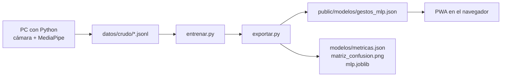

# 06 · Núcleo Python

> **Parte de la guía:** [Índice](./README.md) · **Anterior:** [05](./05-datos-y-almacenamiento.md) · **Siguiente:** [07](./07-arquitectura-y-flujo.md)

## 1. Para qué existe `nucleo/`

`nucleo/` **no es la app**. Es el laboratorio de entrenamiento:

- Graba datos (landmarks y blendshapes) con la cámara del PC.
- Entrena el clasificador MLP.
- Exporta el modelo a un JSON que la PWA consume.
- Genera métricas y una matriz de confusión.

La app web no ejecuta Python. El teléfono tampoco. Python solo se usa en el PC de desarrollo.



## 2. Estructura del paquete

| Archivo | Responsabilidad |
| --- | --- |
| `configuracion.py` | Constantes compartidas: gestos, 52 categorías de rostro, índices del rostro, rutas y tamaño de entrada |
| `geometria.py` | Distancias, ángulos, extensión de dedos y normalización de la mano |
| `caracteristicas-mano.py` | Vector de **69** para el modelo de mano (el que está entrenado y en uso) |
| `caracteristicas.py` | Vector de 127 (mano + rostro), espejo de la mano izquierda y geometría mano-cara — esquema preparado, sin modelo exportado |
| `importar_landmarks.py` | Importa landmarks públicos de **HaGRID** (`HandLandmarks.csv`) y genera los negativos sintéticos de `ninguno` |
| `entrenar_mano.py` | **Entrena el MLP de mano 69 → 128 → 64 → 10 y exporta `gestos_mano_mlp.json`** (el que usa la app) |
| `dataset.py` | Lectura de JSONL, resumen, aumento y split por sesión/persona |
| `recolectar.py` | Abre la cámara, muestra landmarks y guarda muestras |
| `entrenar.py` | Carga datos, aumenta, entrena el MLP, elige umbral y evalúa |
| `exportar.py` | Convierte el modelo de scikit-learn al JSON de la PWA |
| `descargar_modelos.py` | Descarga los `.task` de MediaPipe a `public/modelos/` |
| `tests/` | Pruebas de features, dataset y entrenamiento |

## 3. El dataset

### Formato
Cada línea de `nucleo/datos/crudo/*.jsonl` es una muestra:

```json
{
  "version": 1,
  "sesion": "20261102-103000",
  "persona": "william",
  "etiqueta": "like",
  "timestamp": 1762000000.0,
  "handedness": "Right",
  "gesto_integrado": { "nombre": "Thumb_Up", "confianza": 0.94 },
  "landmarks_mano": [[0.5, 0.6, 0.0], "..."],
  "landmarks_rostro": [[0.5, 0.2, 0.0], "..."],
  "blendshapes": { "mouthPressLeft": 0.4, "..." }
}
```

- `landmarks_mano`: 21 puntos × 3 coordenadas, o `null`.
- `landmarks_rostro`: 478 puntos × 3 coordenadas, o `null`.
- `blendshapes`: 52 expresiones, o `null`.
- `etiqueta`: una de las diez del modelo entrenado (`fist`, `llamada`, `ninguno`, `ok`, `one`, `palm`, `peace`, `pistola`, `rock`, `stop`) o una de las que resuelven las reglas (`like`, `silencio`, `mewing`, `dislike`, `saludo`).

### Cómo se obtiene el dataset que sí se usó

El modelo en uso **no se grabó con la webcam**: se entrenó con landmarks
públicos de HaGRID, que no exigen tener cámara ni voluntarios.

```powershell
$env:PYTHONPATH = "src"
.\.venv\Scripts\python -m meme_vision.importar_landmarks
```

`importar_landmarks.py` descarga `HandLandmarks.csv` (12 clases, ~1 000 muestras
por clase), se queda con las clases que el modelo de mano distingue sin rostro y
**genera los negativos de `ninguno` de forma sintética**, mezclando pares de
gestos y añadiendo manos ausentes. Eso está declarado en el propio JSON del
modelo y conviene decirlo en la defensa: para una entrega real habría que
sustituir esos negativos por grabaciones propias de reposo.

### Cómo se graba

```powershell
cd nucleo
py -3.14 -m venv .venv
.\.venv\Scripts\pip install -r requirements.txt
$env:PYTHONPATH = "src"
.\.venv\Scripts\python -m meme_vision.descargar_modelos
.\.venv\Scripts\python -m meme_vision.recolectar --persona tu_nombre
```

Teclas del recolector:

| Tecla | Acción |
| --- | --- |
| `1` | Etiqueta `like` y empieza a grabar |
| `2` | Etiqueta `llamada` |
| `3` | Etiqueta `silencio` |
| `4` | Etiqueta `mewing` |
| `0` | Etiqueta `ninguno` (reposo) |
| `Espacio` | Pausa/reanuda |
| `D` | Muestra/oculta puntos del rostro |
| `Q` | Sale |

Se guarda una muestra cada ~100 ms (10 Hz). El archivo se llama `AAAAmmdd-HHMMSS_persona.jsonl`.

### Recomendaciones para un dataset útil

- **3 sesiones o 3 personas** como mínimo.
- **50+ muestras por gesto y sesión**: a 10 Hz son ~5 s efectivos, pero deja margen para acomodarte (el README del núcleo sugiere ~20 s por gesto).
- Variar **distancia** (30/60/90 cm), **fondo**, **luz** y **mano** (izquierda/derecha).
- Grabar `ninguno` con la mano relajada, no solo ausente.
- No mezclar condiciones extremas en una sola sesión: el split por sesión mide generalización.

## 4. Entrenamiento

Hay **dos** entrenadores. El que produjo el modelo que usa la app es
`entrenar_mano`:

```powershell
$env:PYTHONPATH = "src"
.\.venv\Scripts\python -m meme_vision.entrenar_mano
# opciones: --aumento 0  --datos datos/crudo
```

`entrenar.py` es el del esquema de 127 (mano + rostro). Está implementado y
probado, pero **no hay modelo exportado** con él; queda como trabajo futuro.

Pasos internos de `entrenar_mano.py`:

1. **Cargar** todos los `.jsonl` y descartar etiquetas que el modelo de mano no sabe distinguir.
2. **Resumir** total, conteo por etiqueta, sesiones y personas.
3. **Dividir** con `train_test_split`. Aquí está la deuda: el split es **aleatorio por fotograma**, no por sesión/persona, así que las métricas son optimistas.
4. **Aumentar** solo train: espejo, rotación ±8°, escala 0.9–1.1 y ruido.
5. **Escalar** con `StandardScaler`.
6. **Entrenar** `MLPClassifier(hidden_layer_sizes=(128, 64), activation='relu', solver='adam', early_stopping=True)`.
7. **Elegir umbral** en validación maximizando macro F1.
8. **Reentrenar** con train+val.
9. **Evaluar** en test: exactitud, macro F1, F1 ponderado, reporte por clase y matriz de confusión.
10. **Exportar** JSON, métricas y matriz de confusión.

Resultado del modelo en uso (`2026.11.07-0532`): exactitud **94,38 %**, macro F1
**95,27 %**, umbral **0,90**, sobre 11 500 muestras de HaGRID.

### Artefactos

| Archivo | Para qué |
| --- | --- |
| `nucleo/modelos/` | Modelo + escalador para reutilizar en Python, métricas y matriz de confusión |
| `public/modelos/gestos_mano_mlp.json` | **Modelo que consume la PWA** (69 → 128 → 64 → 10) |

### Cómo saber si el modelo sirve

- **Macro F1 alto** y clases equilibradas en la matriz.
- Si una clase se confunde mucho, faltan ejemplos o son ambiguos.
- Si el test es muy superior a la validación, revisa el split.
- Si el modelo acierta en test pero falla en la app, revisa la paridad de features y la calidad de la cámara.

## 5. Exportación a JSON

`exportar.py` transpone los pesos de scikit-learn (`[entradas][salidas]` → `[salidas][entradas]`), copia la media/desviación del escalador y agrega metadatos. La PWA valida:

- `tamano_entrada` coincide con el vector (**69** para mano, 127 para rostro).
- Etiquetas no vacías.
- Capas no vacías y dimensiones coherentes.
- Escalador con un valor por característica.
- Última capa con el número de gestos.

Si algo no cuadra, `mlp.ts` descarta el modelo y usa reglas.

## 6. Pruebas

```powershell
cd nucleo
$env:PYTHONPATH = "src"
.\.venv\Scripts\python -m pytest -q
```

Cubren:

- Vector de 127 y flags.
- Mano izquierda reflejada.
- Geometría de silencio vs. mewing.
- Aumento y split por sesión.
- Entrenamiento con datos sintéticos y exportación de un JSON válido.

En la revisión del 2026-11-02 no se ejecutaron en esta máquina porque faltaban dependencias (`sklearn`); los tests de TypeScript sí pasaron (15/15).

## 7. ¿El teléfono corre Python?

**No.** El teléfono solo ejecuta el navegador:

- HTML, CSS y JavaScript.
- WebAssembly de MediaPipe para los `.task`.
- El MLP en TypeScript (multiplicaciones de matrices).
- El JSON como datos.

Python es la cocina donde se prepara la receta; el JSON es la tarjeta; el navegador sigue la receta. El teléfono no necesita Python ni el dataset.

## 8. Problemas frecuentes

| Problema | Causa / solución |
| --- | --- |
| `No module named meme_vision` | Falta `$env:PYTHONPATH = "src"` |
| No abre la cámara | Otra app la usa; prueba `--camara 1`; en Windows se usa DirectShow |
| Faltan modelos | `python -m meme_vision.descargar_modelos` |
| Macro F1 bajo | Más sesiones/personas, más muestras, revisar matriz de confusión |
| La PWA sigue en reglas | No existe `public/modelos/gestos_mlp.json` o el SW sirve caché vieja |
| Error de scikit-learn | Usa las versiones de `requirements.txt` en un venv limpio |

## 9. Para la defensa

| Pregunta | Respuesta |
| --- | --- |
| ¿Por qué Python y no TypeScript para entrenar? | Python tiene el ecosistema de datos/ML (scikit-learn, matplotlib, MediaPipe); la app solo necesita inferencia. |
| ¿Por qué no entrenar en el teléfono? | Es costoso, innecesario y el modelo es pequeño; se entrena una vez en PC y se exporta. |
| ¿Qué es el split por sesión? | Separar personas/sesiones completas para medir generalización, no memorizar fotogramas. |
| ¿Qué es el aumento? | Crear variantes sintéticas (espejo, rotación, escala, ruido) para que el modelo generalice. |
| ¿Qué exporta el núcleo? | Pesos, sesgos, escalador, etiquetas, umbral y métricas en un JSON. |

## 10. En el proyecto

- Paquete: `nucleo/src/meme_vision/`.
- README detallado: [`nucleo/README.md`](../nucleo/README.md).
- Modelos `.task`: `public/modelos/`.
- Consumo en la PWA: `src/vision/motor.ts`, `src/vision/mlp.ts`.

---

**Siguiente:** [07 · Arquitectura y flujo](./07-arquitectura-y-flujo.md)
