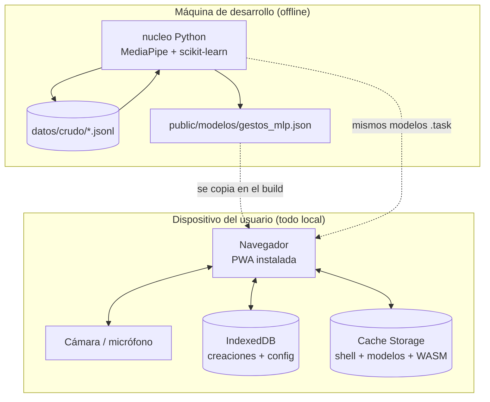
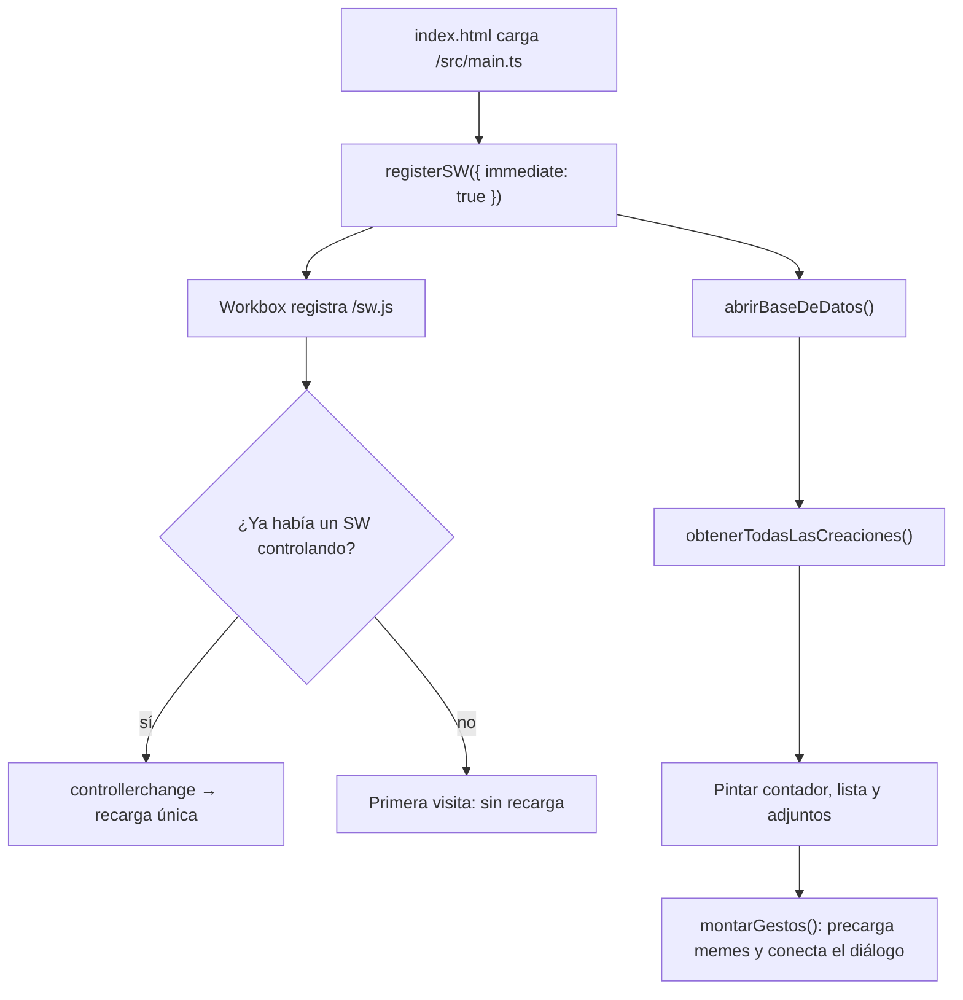
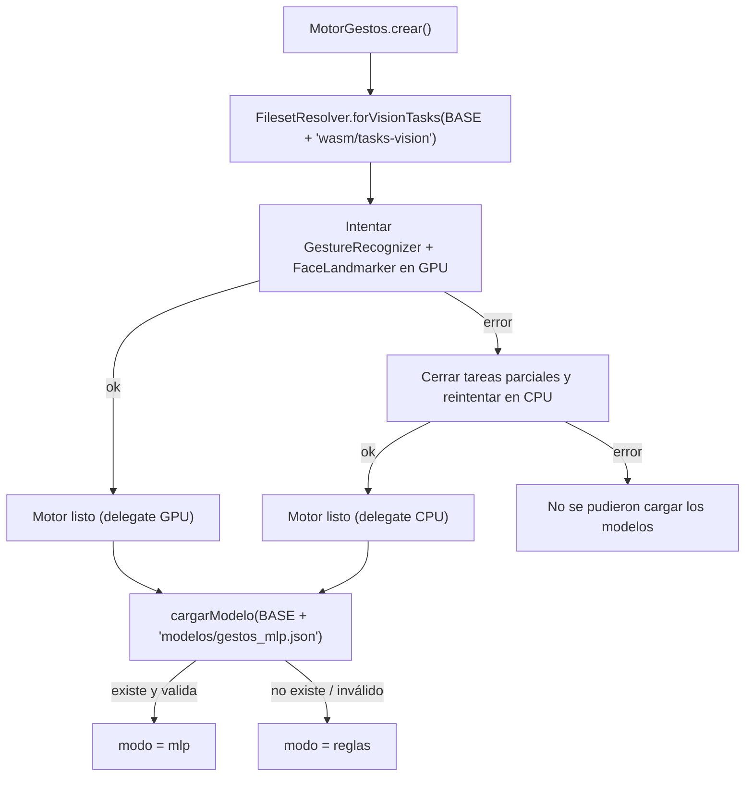
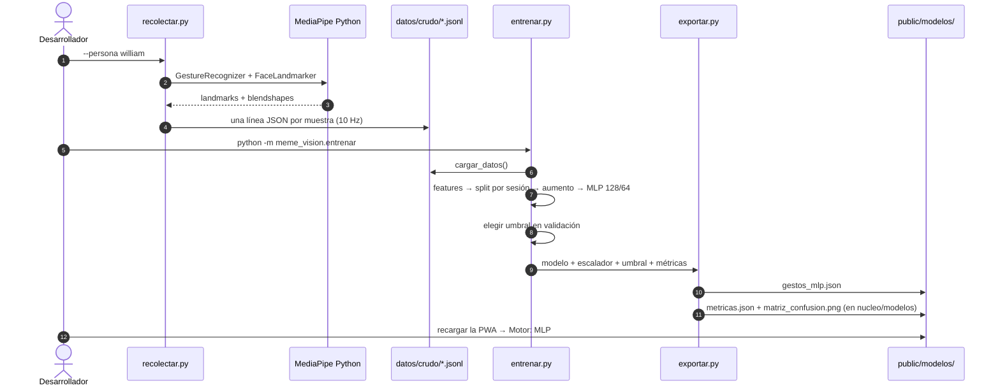
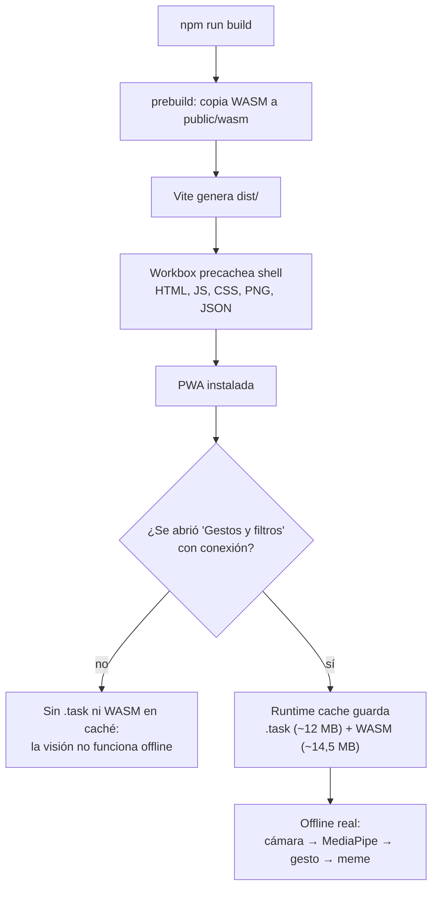
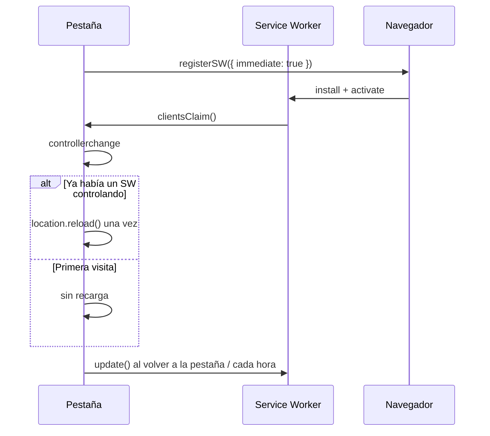
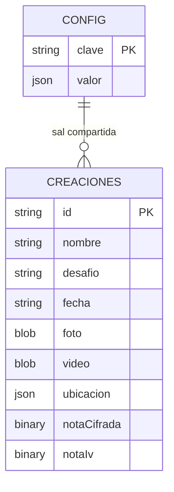
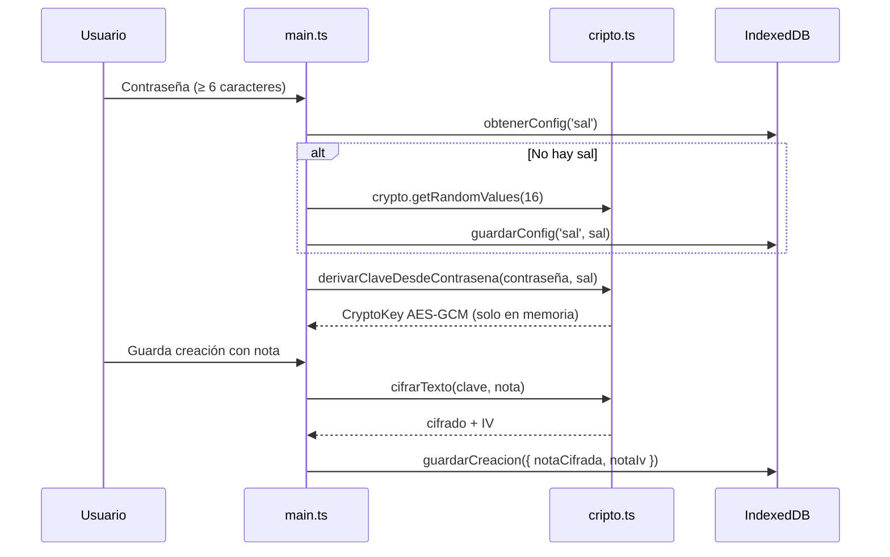
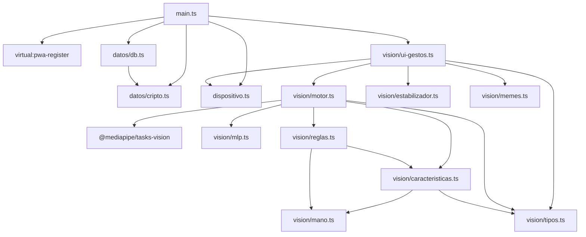
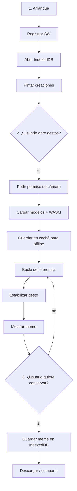

# 07 · Arquitectura y flujo

> **Parte de la guía:** [Índice](./README.md) · **Anterior:** [06](./06-nucleo-python.md) · **Siguiente:** [08](./08-despliegue-cloudflare.md)

Documento reconstruido por ingeniería inversa a partir del código del repo (commit `3614ddc`, 2026-11-02), de la especificación `MemeVision_Especificacion_Requisitos.docx` y del historial de Git. Es el **anexo técnico canónico** de la suite: aquí se explica cómo está armado y cómo fluye, no solo cómo se ejecuta. Los conceptos se explican desde cero en los capítulos [02](./02-pwa-desde-cero.md), [03](./03-responsive-y-movil.md), [04](./04-vision-e-ia.md), [05](./05-datos-y-almacenamiento.md) y [06](./06-nucleo-python.md); este capítulo los integra.

---

## 1. Resumen ejecutivo

MemeVision tiene dos mitades que se comunican por un contrato de datos:

1. **PWA (TypeScript):** captura video, ejecuta MediaPipe en WASM, convierte landmarks en un vector de características (69 para mano, 127 para rostro), clasifica el gesto con un MLP o con reglas, estabiliza la detección y muestra un meme. También conserva las funciones heredadas del curso: instalación PWA, Service Worker, IndexedDB, cifrado, cámara, micrófono y ubicación.
2. **Núcleo Python (`nucleo/`):** importa landmarks públicos de HaGRID, entrena un MLP `128 → 64` con scikit-learn y exporta `public/modelos/gestos_mano_mlp.json`. No corre en producción: es una herramienta de entrenamiento.

El punto de unión es el **vector de características** (69 para mano, 127 para el esquema de rostro) y un **JSON de modelo** con pesos, sesgos, escalador, etiquetas y umbral. La implementación de features existe dos veces (Python y TypeScript) y un test de paridad las mantiene sincronizadas.

**Estado real:** la PWA funciona con el **MLP de mano entrenado** (`gestos_mano_mlp.json`, 69 → 128 → 64 → 10, umbral 0,90, 94,38 % de exactitud) y con las reglas para los gestos de rostro. El esquema de 127 está implementado pero no tiene modelo exportado.

---

## 2. Contexto del sistema



No hay backend. La única comunicación externa es la descarga inicial de la app, los modelos `.task` y el WASM; después todo es local.

---

## 3. Flujo de ejecución en la PWA

### 3.1 Secuencia completa

```mermaid
sequenceDiagram
  autonumber
  actor U as Usuario
  participant UI as main.ts / ui-gestos.ts
  participant CAM as getUserMedia
  participant MP as MediaPipe WASM
  participant FEAT as caracteristicas.ts
  participant CLF as MLP / reglas
  participant STAB as Estabilizador
  participant MEME as memes.ts

  U->>UI: Abre «Gestos y filtros»
  UI->>CAM: Pedir cámara (permiso explícito)
  CAM-->>UI: MediaStream
  UI->>MP: Cargar GestureRecognizer + FaceLandmarker
  Note over MP: GPU primero; si falla, CPU
  loop Cada ~65 ms
    UI->>MP: recognizeForVideo / detectForVideo
    MP-->>UI: 21 landmarks mano + 478 rostro + 52 blendshapes
    UI->>FEAT: extraerCaracteristicas(entrada)
    FEAT-->>UI: Float32Array(69)
    UI->>CLF: predecir / clasificarReglas
    CLF-->>UI: gesto + confianza + origen
    UI->>STAB: actualizar(detección, timestamp)
    STAB-->>UI: gesto estable (o ninguno)
    UI->>MEME: urlMeme(gesto)
    MEME-->>UI: URL de imagen
    UI->>U: Meme + etiqueta + barra de confianza
  end
  U->>UI: Cierra el diálogo
  UI->>CAM: stop() de todas las pistas
  UI->>MP: close() al salir de la página
```

### 3.2 Arranque de la app



El registro del Service Worker y la apertura de IndexedDB son independientes. Si IndexedDB falla, la app queda usable salvo la sección de creaciones (el error se registra en consola).

### 3.3 Bucle de visión

`MotorGestos.detectar(video, timestamp)`:

1. Ignora el fotograma si `video.readyState < 2` o no hay dimensiones.
2. Fuerza timestamps estrictamente crecientes (MediaPipe lo exige).
3. Ejecuta `GestureRecognizer.recognizeForVideo` y `FaceLandmarker.detectForVideo`.
4. Toma la primera mano, el primer rostro y sus blendshapes.
5. Construye `EntradaCuadro` y calcula las reglas geométricas.
6. Si hay modelo, calcula el MLP y decide según el umbral.
7. Devuelve `{ deteccion, entrada }` para pintar landmarks y actualizar la UI.

La UI llama a este método desde `requestAnimationFrame` con un throttle de 65 ms. **No hay Web Worker**: es la brecha principal frente a RNF-02.

---

## 4. Pipeline de visión

### 4.1 Carga de modelos y degradación



- `BASE` es `import.meta.env.BASE_URL`, así que la app tolera desplegarse en un subpath (los modelos y el WASM sí; el manifest y el favicon usan rutas absolutas, ver hallazgos).
- Si el MLP falla en tiempo de inferencia, se captura la excepción y se usan reglas.
- Si el MLP existe pero su confianza es menor que el umbral y las reglas no reconocen nada, se acepta la predicción del MLP con baja confianza (el estabilizador la filtra).

### 4.2 Vector de características

**El que usa el modelo entrenado: 69 valores** (`caracteristicas-mano.ts` / `caracteristicas_mano.py`).

| Rango | Contenido |
| --- | --- |
| 0–62 | 21 landmarks en forma canónica: centrados en la muñeca, escalados por la distancia muñeca → nudillo medio y rotados a un eje de referencia |
| 63 | `1` si hay mano, `0` si no |
| 64–68 | Dedos extendidos: pulgar, índice, medio, anillo y meñique |

**El esquema ampliado: 127 valores** (`caracteristicas.ts` / `caracteristicas.py`), sin modelo exportado.

| Rango | Contenido | Implementación |
| --- | --- | --- |
| 0–62 | 21 landmarks de la mano `(x, y, z)`, centrados en la muñeca y escalados por la distancia muñeca → nudillo medio | `mano.ts` / `geometria.py` |
| 63–114 | 52 blendshapes faciales en orden canónico de MediaPipe | `tipos.ts` / `configuracion.py` |
| 115–122 | Geometría mano/cara: índice-boca, índice-mentón, índice-mandíbula, alcance, pulgar-boca, boca-mentón, offset Y, offset X | `caracteristicas.ts` / `caracteristicas.py` |
| 123–126 | Flags: hay mano, hay rostro, índice extendido, pulgar+meñique | `caracteristicas.ts` / `caracteristicas.py` |

Reglas del vector:

- La mano izquierda se **refleja en X** (`x = -x`) para que el modelo no dependa de la lateralidad.
- El modelo de mano **sí rota** los landmarks a un eje de referencia; el esquema de 127 no rotaba, porque la orientación distingue pulgar arriba de pulgar abajo.
- Si falta un dato, los valores se rellenan con `0` y los flags lo indican.
- `TAMANO_ENTRADA_MANO = 21*3 + 1 + 5 = 69`; `TAMANO_ENTRADA = 21*3 + 52 + 8 + 4 = 127`.

El test `src/vision/paridad.test.ts` compara el vector TypeScript contra un fixture generado por Python; si una implementación cambia sin la otra, falla.

### 4.3 Reglas geométricas

`src/vision/reglas.ts` resuelve los gestos que dependen del rostro y hace de respaldo bajo el umbral.

| Gesto | Condición principal |
| --- | --- |
| `silencio` | Índice extendido y punta a menos de 0,18 de la escala rostro de la boca (segunda oportunidad a 0,34) |
| `mewing` | Índice extendido, debajo de la boca y a menos de 0,30 de la línea de la mandíbula |
| `llamada` | Pulgar y meñique extendidos, índice/medio/anillo cerrados |
| `like` | `Thumb_Up` integrado de MediaPipe con confianza > 0,5; si no, pulgar extendido y por encima de la muñeca |
| `ninguno` | Ninguna condición se cumple |

Las distancias se normalizan por la distancia frente → mentón del rostro, así que no dependen del tamaño del usuario en pantalla.

### 4.4 MLP en TypeScript

`src/vision/mlp.ts` valida y ejecuta el JSON:

```text
entrada (69)
  → (x - media) / desviación
  → capa 1: pesos 128×69 + sesgos, ReLU
  → capa 2: pesos 64×128 + sesgos, ReLU
  → capa de salida: pesos 10×64 + sesgos, softmax
  → argmax + confianza
```

Validaciones: tamaño de entrada, etiquetas no vacías, capas no vacías, dimensiones del escalador, coherencia de pesos/sesgos y que la última capa coincida con el número de gestos. Un JSON inválido se descarta sin romper la app.

### 4.5 Estabilizador

`Estabilizador` evita que el meme parpadee:

- Ventana de **8** fotogramas; se acepta un gesto si aparece en **5**.
- Solo cuenta detecciones con confianza ≥ `confianzaMinima` (0,6 por defecto; en la UI se usa `min(0.6, umbral del modelo)`).
- **Cooldown** de 1,2 s entre cambios de gesto.
- **Retención** de 2 s: si se pierde la mano, el meme permanece antes de volver a “sin gesto”.

### 4.6 Selección de memes

`memes.ts` usa `import.meta.glob('../assets/memes/**/*.png', { eager: true, query: '?url' })`. Vite procesa las imágenes, les añade hash y las incluye en el precaché. Si hay varias variantes por gesto, rota entre ellas; si no hay ninguna, cae a `_sin_gesto/esperando.png`.

---

## 5. Flujo de entrenamiento

### 5.1 Secuencia



### 5.2 Decisiones de diseño

- **Split por sesión o persona**, no por fotograma. Si hay una sola sesión, cae a un split estratificado y avisa: las métricas quedan optimistas por fuga de datos.
- **Aumento solo en train**: espejo, rotación ±8°, escala 0.9–1.1, ruido gaussiano y jitter de blendshapes.
- **MLP `128 → 64`**, ReLU, Adam, `early_stopping`, pesos balanceados por clase.
- **Umbral** barrido de 0,30 a 0,90 en validación con macro F1; luego se reentrena con train+val y se evalúa en test.
- Artefactos: `nucleo/modelos/mlp.joblib` (scikit-learn), `metricas.json`, `matriz_confusion.png` y el JSON web.
- El dataset crudo (`*.jsonl`) y el `.joblib` están ignorados por Git; el JSON web sí se versiona cuando existe.

### 5.3 Contrato del modelo

```json
{
  "version": "2026.11.07-0532",
  "creado": "2026-11-07T05:32:00+00:00",
  "gestos": ["fist", "llamada", "ninguno", "ok", "one", "palm", "peace", "pistola", "rock", "stop"],
  "tamano_entrada": 69,
  "escalador": { "media": [69 números], "desviacion": [69 números] },
  "capas": [
    { "pesos": ["128×69"], "sesgos": ["128"] },
    { "pesos": ["64×128"], "sesgos": ["64"] },
    { "pesos": ["10×64"], "sesgos": ["10"] }
  ],
  "umbral": 0.9,
  "metricas": { "exactitud": 0.9438, "macro_f1": 0.9527, "por_clase": {} }
}
```

`gestos` define el orden de las salidas; la PWA no asume el orden de `ETIQUETAS_ENTRENAMIENTO`.

---

## 6. Flujo PWA, caché y offline

### 6.1 Instalación y primera carga



**Consecuencia práctica:** el flujo de la especificación “instalar → desconectar → usar” solo se cumple si el usuario abrió la vista de gestos al menos una vez con red. Para que la demo sea robusta conviene precargar los modelos o añadir un paso explícito de “Preparar modo offline”.

### 6.2 Estrategias de caché

| Ruta | Estrategia | Caché | Configuración |
| --- | --- | --- | --- |
| Shell (`**/*.{html,js,css,png,json}`) | Precache | `workbox-precache` | Generada en el build |
| `/assets/meme-vision-(icon\|screenshot)` | CacheFirst | `imagenes` | 60 entradas, 30 días |
| `/api/` | NetworkFirst | `api-memes` | Sin timeout |
| `/modelos/gestos_mlp.json` | NetworkFirst | `modelo-gestos` | Timeout 3 s |
| `/modelos/` (`.task`) | CacheFirst | `modelos-vision` | 12 entradas, 30 días |
| `/wasm/` | CacheFirst | `wasm-vision` | 12 entradas, 30 días |

Notas:

- `skipWaiting` + `clientsClaim` + `cleanupOutdatedCaches`: el SW nuevo toma el control y elimina cachés viejas.
- La app comprueba actualizaciones al volver a la pestaña y cada hora; recarga una sola vez si ya había un SW controlando.
- `gestos_mlp.json` también entra en el precaché si existe al momento del build (por `**/*.json`), lo que da offline inmediato al modelo.

### 6.3 Actualización del Service Worker



---

## 7. Almacenamiento y seguridad

### 7.1 Esquema IndexedDB



- Base `memevision-db`, versión 2.
- v1 crea `creaciones` (con índice `porDesafio`) y `config`.
- v2 añade el índice `porFecha` sin perder datos.
- `foto`, `video` y `ubicacion` no cambian el esquema: IndexedDB guarda la forma que tenga el objeto.

### 7.2 Cifrado de notas



- PBKDF2-SHA-256, 100 000 iteraciones, sal de 16 bytes.
- AES-GCM 256 con IV de 12 bytes.
- La contraseña no se persiste; al recargar hay que ingresarla de nuevo para leer notas.
- Los datos planos (nombre, desafío, fecha) siguen siendo consultables por índice.

---

## 8. Mapa de dependencias



`src/vision/` no depende de `main.ts` ni del DOM salvo `ui-gestos.ts`, que es la capa de presentación. Esa separación es la parte más limpia del proyecto.

---

## 9. Inventario: heredado vs nuevo

| Bloque | Commits | Archivos principales | Estado |
| --- | --- | --- | --- |
| Entrega inicial | `c1f5f4f` | `index.html`, `manifest.json`, `sw.js` manual | Reemplazado por Workbox, pero la UI y el manifest siguen |
| PWA y caché manual | `b5948d7` | `sw.js`, estrategias, versionado | Migrado a Workbox |
| Workbox | `9d0f8d6`, `1584f7f`, `c28e977` | `vite.config.ts`, `src/main.ts` | Vigente |
| IndexedDB + Web Crypto | sesión 22 | `src/datos/db.ts`, `src/datos/cripto.ts` | Vigente |
| Cámara/micrófono/ubicación | `9537a4b`, `e1ed1ae` | `src/dispositivo.ts`, `src/main.ts` | Vigente |
| Cámara responsive y visor | `a3e30d1`, `c81246d` | `src/main.ts`, `src/style.css` | Vigente |
| Actualización PWA | `9454b71` | `vite.config.ts`, `src/main.ts` | Vigente |
| **Núcleo de gestos** | `0dd2d7a`, `3614ddc` | `src/vision/*`, `nucleo/*`, `public/modelos/*.task`, `scripts/copiar-wasm.mjs` | **Nuevo** |

Lo heredado no se reescribió: se extendió. Por eso `main.ts` conserva el HTML en template string y toda la lógica de cámara/creaciones en un solo archivo, mientras que la parte nueva sí está modularizada.

---

## 10. Hallazgos de la revisión

### 10.1 Verificado

- `npm test`: **13 archivos, 65 pruebas, 0 fallos**.
- `npm run build`: **30 entradas de precaché (1.961,28 KiB)**, `dist/sw.js` y `dist/workbox-*.js` generados.
- Smoke test en navegador sobre `npm run preview`:
  - El shell carga sin errores de consola.
  - El Service Worker de Workbox se registra (`/sw.js`).
  - El diálogo «Gestos y filtros» abre y solicita cámara.
  - IndexedDB guarda una creación y la conserva tras recargar.
- El churn temporal de `package-lock.json` (72 líneas de metadatos `libc`) se restauró. Los cambios de esta revisión son de documentación y siguen sin commit: `README.md`, `CHANGELOG.md`, la suite `docs/` y el enlace corregido en `evidencias/LEEME.md`.

### 10.2 Problemas de documentación

1. **No había `README.md` en la raíz del repo.** La suite `docs/` y el README lo corrigen.
2. `evidencias/LEEME.md` referenciaba `../auditoria/verificacion-s22.txt`, que no existe. El propio `auditoria/LEEME.md` lo marca como pendiente.
3. `INDICE-PWA.md` estaba desactualizado: decía que no había código de visión y que el último commit era `e19f5e9`.
4. La especificación pide Web Workers (RNF-02) y la implementación no los usa; conviene que la documentación del proyecto lo declare como brecha consciente, no como omisión.
5. `nucleo/README.md` está completo; el vacío documental estaba en la PWA heredada.

### 10.3 Brechas frente a la especificación

| ID | Brecha | Impacto | Comentario |
| --- | --- | --- | --- |
| RNF-02 | Inferencia en el hilo principal | Medio | `requestAnimationFrame` + throttle; la UI sigue fluida en equipos modernos, pero no cumple el requisito literal |
| RF-08/09 | Modelos y WASM no precargados | Alto para la demo | Sin abrir «Gestos y filtros» online, no hay visión offline |
| RF-10 | Los memes de gestos no se guardan | Medio | Solo se guardan creaciones manuales (foto/vídeo) |
| RF-11 | No hay descargar/compartir meme | Medio | No hay botón ni Web Share API |
| RF-12 | No hay aviso de conexión | Bajo | El usuario no sabe que la primera carga necesita red |
| Despliegue | `manifest.json` e `index.html` usan rutas absolutas `/` | Bajo en Cloudflare Pages | En la raíz del dominio funciona; en un subpath (p. ej. GitHub Pages) fallarían íconos, `start_url` y favicon. El WASM/modelos sí usan `BASE_URL` |

RF-13 sí se cumple: la vista muestra “Pidiendo permiso…”, “Cargando modelos…”, la etiqueta del gesto, la barra de confianza y los FPS. Una barra de progreso de carga sería una mejora, no una brecha.

### 10.4 Riesgos técnicos

- **Doble recarga potencial:** `registerType: 'autoUpdate'` y el listener manual de `controllerchange` conviven. En la práctica se evita con la bandera `recargando`, pero conviene probarlo en un dispositivo real.
- **Peso de la primera carga:** ~12 MB de modelos `.task` + ~14,5 MB de WASM SIMD (o ~12,9 MB no-SIMD) además del shell. En redes lentas la primera apertura de gestos puede tardar.
- **Una sola mano y un solo rostro:** `numHands: 1`, `numFaces: 1`. Suficiente para los gestos actuales; no escala a gestos de dos manos.
- **Dataset vacío:** el MLP es opcional por diseño, pero la evaluación final no puede demostrar el clasificador entrenado sin grabar datos.
- **`main.ts` monolítico:** 792 líneas con HTML, cámara, cifrado, creaciones y montaje de gestos. Es la deuda técnica principal para mantener el flujo.

---

## 11. Propuesta de flujo limpio

### 11.1 Flujo objetivo (runtime)



Las diferencias con el flujo actual son tres: **preparación offline explícita**, **guardar el meme generado** y **salida descargar/compartir**. Son exactamente las brechas RF-08/09/10/11.

### 11.2 Refactor recomendado de `main.ts` (no aplicado)

| Módulo propuesto | Se lleva | Riesgo |
| --- | --- | --- |
| `app/plantilla.ts` o HTML estático | El template string gigante | Bajo: mover markup |
| `app/creaciones.ts` | Formulario, lista, visor, object URLs | Medio |
| `app/camara-dialogo.ts` | Diálogo de cámara, modos Foto/Vídeo, grabadora, ubicación | Medio |
| `app/cifrado-ui.ts` | Contraseña, activar cifrado, mostrar nota | Bajo |
| `app/sw.ts` | Registro y comprobación de actualizaciones | Bajo |
| `main.ts` | Solo composición y arranque | Bajo |

No se hizo en esta revisión para no mezclar documentación con un refactor grande sin pruebas de UI automatizadas.

### 11.3 Prioridades sugeridas

1. **Alta:** precargar `.task` y WASM (o botón “Preparar offline”) para que la demo funcione sin abrir gestos antes.
2. **Alta:** grabar el dataset y exportar `gestos_mlp.json`; validar el MLP en un dispositivo real.
3. **Media:** mover la inferencia a un Web Worker (RNF-02) con `OffscreenCanvas` o transferencia de `ImageBitmap`.
4. **Media:** guardar los memes generados en IndexedDB y añadir descargar/compartir (RF-10/11).
5. **Media:** extraer `main.ts` en módulos y eliminar `src/counter.ts` (scaffold de Vite sin uso).
6. **Baja:** aviso de conexión, indicador de carga y rutas relativas para subpath.

---

## 12. Registro de verificación

| Fecha | Comprobación | Resultado |
| --- | --- | --- |
| 2026-11-22 | `npm test` | 65/65 en 13 archivos, tras incorporar el MLP de mano |
| 2026-11-02 | `npm run build` | OK; 26 módulos; 17 precache entries; `dist/sw.js` |
| 2026-11-02 | Smoke test navegador (`preview`) | Shell, SW, diálogo de gestos e IndexedDB OK |
| 2026-11-02 | `git status` | Lockfile restaurado; solo cambios de documentación sin commit |
| Pendiente | `pytest` en `nucleo/` | No ejecutado: faltan dependencias Python en esta máquina (sklearn) |
| Pendiente | Cámara real / offline en dispositivo | Requiere HTTPS y un dispositivo con cámara |

---

## 13. Referencias

- Especificación: [`MemeVision_Especificacion_Requisitos.docx`](../../../documentacion/MemeVision_Especificacion_Requisitos.docx) (documento del curso, fuera del repo).
- Propuesta: [`MemeVision_Propuesta_PWA.pptx`](../../../documentacion/MemeVision_Propuesta_PWA.pptx) (documento del curso, fuera del repo).
- README del proyecto: [`../README.md`](../README.md).
- Núcleo Python: [`../nucleo/README.md`](../nucleo/README.md).
- Historial: `git log --oneline --decorate` en la raíz del repo.
- Capítulos relacionados: [02 · PWA](./02-pwa-desde-cero.md), [03 · Responsive y móvil](./03-responsive-y-movil.md), [04 · Visión e IA](./04-vision-e-ia.md), [05 · Datos](./05-datos-y-almacenamiento.md), [06 · Núcleo Python](./06-nucleo-python.md), [08 · Despliegue](./08-despliegue-cloudflare.md).
