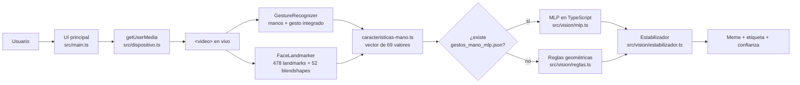
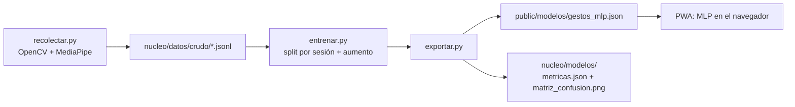

# MemeVision

PWA de visión artificial **on-device** que convierte gestos de la mano y del rostro en memes. La cámara, la inferencia y el almacenamiento ocurren en el navegador: el video nunca sale del dispositivo.

- **Frontend:** Vite + TypeScript + `vite-plugin-pwa` (Workbox).
- **Visión:** MediaPipe Tasks Vision (GestureRecognizer + FaceLandmarker) sobre WASM.
- **Clasificador propio:** MLP exportado desde Python y ejecutado en TypeScript.
- **Datos locales:** IndexedDB + Web Crypto (nota privada cifrada).
- **Núcleo de entrenamiento:** Python + MediaPipe + scikit-learn en `nucleo/`.

> **Estado actual (2026-11-22):** build de producción y **65 pruebas TypeScript** en verde. El **MLP de mano está entrenado y en uso**: `public/modelos/gestos_mano_mlp.json` (69 → 128 → 64 → 10, umbral 0,90, 94,38 % de exactitud). Los gestos que dependen del rostro los resuelven las reglas geométricas.

> **Guía de estudio y defensa:** [`docs/README.md`](docs/README.md). Explica desde cero PWA, responsive/móvil, visión e IA, datos, Python, arquitectura y despliegue en Cloudflare Pages.

---

## Inicio rápido

```bash
npm install
npm run dev      # predev copia el WASM de MediaPipe a public/wasm/
npm test         # Vitest: 65 pruebas
npm run build    # tsc + Vite + Workbox (genera dist/sw.js)
npm run preview  # sirve dist/ en http://localhost:4173
```

La cámara y el micrófono requieren `https` o `localhost`.

> Si tu entorno define `NODE_ENV=production`, `npm install` omite las devDependencies. Usa `npm install --include=dev` para instalar Vite, TypeScript y Vitest.

---

## Flujo de la aplicación



Cada fotograma se procesa como máximo cada **65 ms** (~15 inferencias/s). El estabilizador exige que un gesto aparezca en **5 de los últimos 8** fotogramas, aplica un cooldown de **1,2 s** entre cambios y retiene el gesto **2 s** antes de volver a “sin gesto”.

### Gestos reconocidos

| Tecla del recolector | Etiqueta | Gesto | Carpeta de memes |
| --- | --- | --- | --- |
| `1` | `like` | Pulgar arriba | `src/assets/memes/like/` |
| `2` | `llamada` | Pulgar y meñique extendidos | `src/assets/memes/llamada/` |
| `3` | `silencio` | Índice vertical sobre los labios | `src/assets/memes/silencio/` |
| `4` | `mewing` | Índice tocando la mandíbula | `src/assets/memes/mewing/` |
| `0` | `ninguno` | Mano relajada / sin gesto | `src/assets/memes/_sin_gesto/` |

### Prioridad de clasificación

1. Si hay modelo y su confianza supera el umbral → **MLP**.
2. Si el MLP no está seguro pero las reglas reconocen algo → **reglas**.
3. Si el MLP existe y no hay regla → se usa la predicción del MLP con su confianza.
4. Si no hay mano → `ninguno`.

El JSON del modelo manda sobre el orden de etiquetas; si cambia el tamaño de entrada o la forma de las capas, `mlp.ts` lo rechaza y la app sigue con reglas.

---

## Flujo de entrenamiento

El paquete `nucleo/` no corre la app: graba landmarks, entrena y exporta un JSON pequeño que la PWA ejecuta en el navegador.



```powershell
cd nucleo
py -3.14 -m venv .venv
.\.venv\Scripts\pip install -r requirements.txt
$env:PYTHONPATH = "src"

.\.venv\Scripts\python -m meme_vision.descargar_modelos
.\.venv\Scripts\python -m meme_vision.recolectar --persona tu_nombre
.\.venv\Scripts\python -m meme_vision.entrenar_mano
```

- El código soporta split **por sesión/persona**; el modelo en uso se entrenó con split aleatorio por fotograma (deuda declarada: métricas optimistas).
- Aumento solo en train: espejo, rotación ±8°, escala 0.9–1.1 y ruido.
- MLP `128 → 64`, umbral elegido en validación y evaluación final en test.
- El detalle completo, el vector de 69 valores y las reglas del dataset están en [`nucleo/README.md`](nucleo/README.md).

El modelo ya está exportado: `public/modelos/gestos_mano_mlp.json` (69 → 128 → 64 → 10, umbral 0,90) y la app muestra `Motor: MLP …`.

---

## PWA, caché y offline

La PWA viene del trabajo previo (sesiones 17–24) y se extendió para la visión.

| Recurso | Estrategia | Cuándo se guarda |
| --- | --- | --- |
| Shell: HTML, JS, CSS, memes PNG, JSON | **Precache** de Workbox | En el build / instalación |
| `.task` de MediaPipe (`gesture_recognizer`, `face_landmarker`) | `CacheFirst` en `/modelos/` | Primera vez que se abre «Gestos y filtros» |
| WASM de MediaPipe | `CacheFirst` en `/wasm/` | Primera inferencia |
| `gestos_mlp.json` | `NetworkFirst` (3 s) | Primera carga del modelo |
| `/api/` (futuro) | `NetworkFirst` | Primera petición |
| Íconos y screenshots | `CacheFirst` con expiración | Primera carga |

**Importante para la demo offline:** los modelos `.task` (~12 MB) y el WASM (~14,5 MB de la variante SIMD) se guardan en la **primera** visita a «Gestos y filtros», no durante la instalación. Antes de desconectar, abre esa vista una vez con conexión. Después, el flujo `cámara → MediaPipe → gesto → meme` funciona sin red.

El Service Worker se genera con `skipWaiting` + `clientsClaim`; la app comprueba actualizaciones al volver a la pestaña y cada hora.

### Almacenamiento local

- Base `memevision-db`, versión 2.
- Store `creaciones`: fotos, videos, ubicación y nota cifrada; índices `porDesafio` y `porFecha`.
- Store `config`: sal del cifrado y ajustes.
- Nota privada: PBKDF2-SHA-256 (100 000 iteraciones) → AES-GCM 256. La contraseña nunca se guarda; la clave vive solo en memoria.

---

## Mapa de módulos

| Archivo | Origen | Responsabilidad |
| --- | --- | --- |
| `src/main.ts` | Heredado + extendido | Shell de la UI, cámara en vivo, creaciones, cifrado y montaje de gestos |
| `src/dispositivo.ts` | Heredado (sesión 24) | Cámara, micrófono, ubicación, MediaRecorder, permisos y errores |
| `src/datos/db.ts` | Heredado (sesión 22) | IndexedDB versionada, CRUD y configuración |
| `src/datos/cripto.ts` | Heredado (sesión 22) | PBKDF2 + AES-GCM |
| `src/vision/motor.ts` | **Nuevo** | Carga MediaPipe (GPU→CPU), ejecuta ambos modelos y decide MLP/reglas |
| `src/vision/caracteristicas-mano.ts` | **Nuevo** | Vector de 69 valores compartido con Python |
| `src/vision/caracteristicas.ts` | Heredado | Vector de 127 (mano + rostro), sin modelo exportado |
| `src/vision/fusion.ts` | **Nuevo** | Prioridad entre reglas y los dos MLP |
| `src/vision/mano.ts` | **Nuevo** | Geometría, extensiones y normalización de la mano |
| `src/vision/reglas.ts` | **Nuevo** | Clasificación geométrica de respaldo |
| `src/vision/mlp.ts` | **Nuevo** | Validación e inferencia del JSON exportado |
| `src/vision/estabilizador.ts` | **Nuevo** | Ventana, cooldown y retención para evitar parpadeos |
| `src/vision/memes.ts` | **Nuevo** | Descubrimiento y rotación de imágenes por gesto |
| `src/vision/ui-gestos.ts` | **Nuevo** | Diálogo «Gestos en vivo», bucle de cámara y dibujo de landmarks |
| `nucleo/src/meme_vision/` | **Nuevo** | Recolección, features, dataset, entrenamiento y exportación |
| `vite.config.ts` | Heredado + extendido | Workbox y reglas de caché para modelos/WASM |
| `public/manifest.json`, `public/assets/` | Heredado (sesiones 15–16) | Instalabilidad e íconos |
| `public/modelos/*.task` | **Nuevo** | Modelos preentrenados de MediaPipe |
| `scripts/copiar-wasm.mjs` | **Nuevo** | Copia el WASM al `public/` en `predev`/`prebuild` |

---

## Qué se heredó y qué se agregó

El repositorio nació con la entrega `v1.0.1` (2026-09-18) y creció con las sesiones del curso:

| Commit | Fecha | Aporte |
| --- | --- | --- |
| `c1f5f4f` | 2026-09-18 | Primera entrega: Vite + manifest + `sw.js` manual |
| `b5948d7` | 2026-09-26 | Service Worker versionado, limpieza y 5 estrategias de caché (sesiones 17–21) |
| `9d0f8d6` / `1584f7f` | 2026-10-09 | Migración a Workbox con `vite-plugin-pwa` (sesión 34) |
| `9537a4b` | 2026-10-16 | Cámara, micrófono y ubicación (sesión 24) |
| `e1ed1ae` / `a3e30d1` / `c81246d` | 2026-10-16/17 | Modo Foto/Vídeo con audio, cámara responsive, visor de fotos |
| `9454b71` | 2026-10-17 | `skipWaiting`/`clientsClaim` y comprobación de versiones |
| `0dd2d7a` | 2026-10-29 | **Nuevo:** núcleo de gestos (MediaPipe + MLP + reglas, Python y tests) |
| `3614ddc` | 2026-10-29 | Merge del PR #6 (`feat/modelo-python`) |

La revisión del 2026-11-02 verificó que lo heredado sigue funcionando: el shell carga, el Service Worker se registra, IndexedDB guarda y recupera creaciones tras recargar, y el diálogo de gestos abre con el motor de reglas.

---

## Estado frente a la especificación

| Requisito | Estado | Nota |
| --- | --- | --- |
| RF-01/02 Permiso y captura de cámara | Cumplido | Diálogo de permiso + `getUserMedia` |
| RF-03/04/05/06 Landmarks, gestos, meme y feedback | Cumplido | MediaPipe + reglas/MLP + memes + etiqueta/confianza |
| RF-07 Instalación PWA | Cumplido | Manifest completo + SW |
| RF-08/09 Offline y modelo local | Parcial | Funciona tras la primera carga online de modelos/WASM; no se precargan |
| RF-10 Historial de memes | Parcial | Se guardan creaciones (foto/vídeo), no los memes generados por gesto |
| RF-11 Descargar/compartir meme | Pendiente | No implementado |
| RF-12 Aviso de conexión | Pendiente | No implementado |
| RF-13 Feedback de procesamiento | Cumplido | Texto de estado (“Cargando modelos…”), confianza, FPS y etiqueta; sin barra de progreso |
| RNF-01 Privacidad | Cumplido | Todo ocurre en el cliente |
| RNF-02 Inferencia en Web Worker | **Pendiente** | La inferencia corre en el hilo principal con `requestAnimationFrame` |
| RNF-03 Near real-time | Cumplido | Throttle de 65 ms + estabilizador |
| RNF-04 Disponibilidad offline | Cumplido* | *Después de la primera carga de modelos |
| RNF-05/06/07/09 | Cumplido | Permisos, navegadores modernos, responsive, permisos revocables |
| RNF-08 Desacoplamiento | Parcial | `src/vision/` está desacoplado; `main.ts` concentra la UI heredada |
| RNF-10 Límites de almacenamiento | Parcial | Cachés con expiración; IndexedDB sin política de limpieza |

El análisis detallado, los diagramas de secuencia y la propuesta de flujo limpio están en [`docs/07-arquitectura-y-flujo.md`](docs/07-arquitectura-y-flujo.md). La guía de estudio completa empieza en [`docs/README.md`](docs/README.md) y el despliegue está en [`docs/08-despliegue-cloudflare.md`](docs/08-despliegue-cloudflare.md).

---

## Pruebas

```bash
npm test
```

Cubre:

- `caracteristicas-mano.test.ts` — vector de 69, forma canónica y flags.
- `paridad.test.ts` — mismo vector que Python (fixture compartido).
- `reglas.test.ts` — like, llamada, silencio, mewing y mano abierta.
- `mlp.test.ts` — inferencia, validación y errores de tamaño.
- `estabilizador.test.ts` — ventana, cooldown y retención.

Resultado de la revisión: **13 archivos, 65 pruebas, todas en verde**.

Pruebas de Python (requieren las dependencias de `nucleo/requirements.txt`):

```powershell
cd nucleo
$env:PYTHONPATH = "src"
.\.venv\Scripts\python -m pytest -q
```

---

## Solución de problemas

- **No abre la cámara:** usa `https` o `localhost`; revisa el candado de permisos del navegador.
- **`No module named meme_vision`:** falta `$env:PYTHONPATH = "src"` en `nucleo/`.
- **Faltan modelos `.task`:** ejecuta `python -m meme_vision.descargar_modelos`.
- **Falta el WASM:** ejecuta `npm run dev` o `npm run build` (el script `predev`/`prebuild` lo copia).
- **La app sigue en reglas:** no existe `public/modelos/gestos_mano_mlp.json` o el Service Worker sirve una versión vieja; recarga con la caché actualizada.
- **La demo offline no reconoce gestos:** abre «Gestos y filtros» una vez con conexión para cachear `.task` y WASM.
- **`vitest` no se reconoce:** `npm install --include=dev` (ver nota de `NODE_ENV`).
- **Cambios que no aparecen:** cierra todas las pestañas de la PWA o actualiza el Service Worker; `skipWaiting` + `clientsClaim` ya están activos.

---

## Estructura

```text
Meme-Vision/
├─ docs/                      # guía de estudio y defensa (índice en docs/README.md)
├─ src/
│  ├─ main.ts                 # shell y flujos heredados
│  ├─ dispositivo.ts          # cámara, micrófono, ubicación
│  ├─ datos/                  # IndexedDB + Web Crypto
│  ├─ vision/                 # motor, features, reglas, MLP, estabilizador, UI
│  └─ assets/memes/           # una carpeta por gesto
├─ nucleo/                    # entrenamiento Python (no corre en la PWA)
│  ├─ src/meme_vision/
│  ├─ tests/
│  └─ README.md
├─ public/
│  ├─ manifest.json
│  ├─ assets/                 # íconos y screenshots
│  ├─ modelos/                # .task + (gestos_mlp.json cuando se entrene)
│  └─ wasm/                   # generado por scripts/copiar-wasm.mjs
├─ scripts/copiar-wasm.mjs
├─ evidencias/                # capturas de las sesiones
├─ CHANGELOG.md               # cambios para el despliegue
├─ vite.config.ts
└─ README.md
```

---

Proyecto académico de la Electiva PWA — UPTC, Ingeniería de Sistemas y Computación. Especificación y propuesta en `../../documentacion/`.
